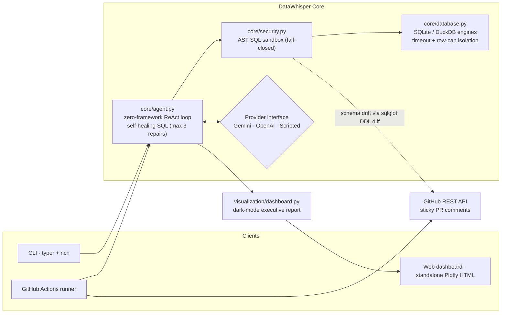
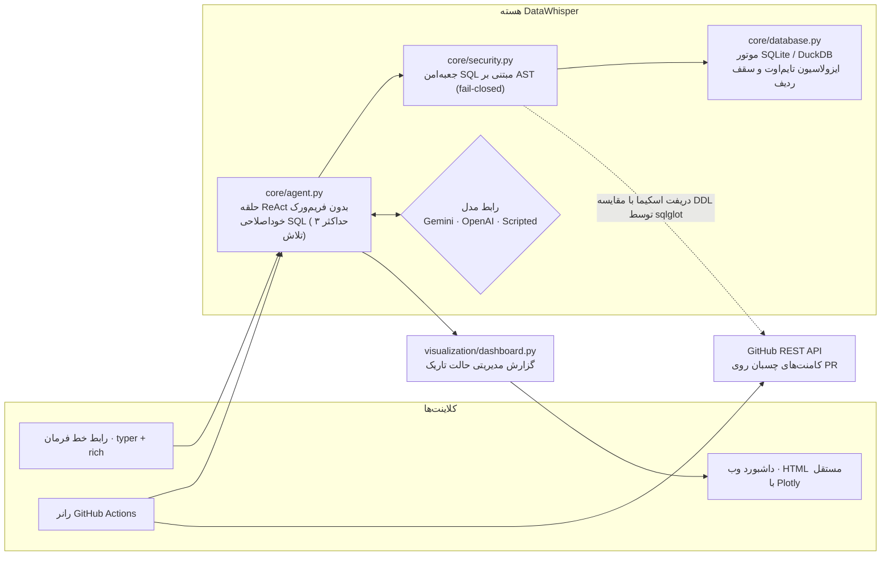

# DataWhisper

Ask questions about your data in plain language, and get a bot that reviews database changes on every pull request.

[](https://github.com/Green-tero/datawhisper/actions/workflows/ci.yml)


**Language / زبان:** click a section below to open it. English is open by default.

<details open>
<summary><b>🇬🇧 &nbsp;English</b></summary>

<br>

**Contents:** [What it does](#what-it-does) · [Features](#features) · [Quickstart](#quickstart) · [Try it in 60 seconds](#try-it-in-60-seconds) · [How it fits together](#how-it-fits-together) · [Commands](#commands) · [GitHub Action](#using-it-as-a-github-action) · [Configuration](#configuration) · [Development](#development) · [License](#license)

## What it does

DataWhisper has two jobs.

**1. A local tool for exploring data.** You get a command-line app (built with `typer` and `rich`) and a dark-mode Plotly dashboard. You ask a question about a SQLite, DuckDB or CSV dataset, and DataWhisper writes the SQL, runs it, and fixes its own mistakes if the query fails.

**2. A GitHub bot for pull requests.** When a PR changes your database schema, the bot works out what changed (added, removed or retyped columns, dropped tables) and how query speed moved between the old and new versions. It posts the result as a single comment that gets updated on every push, so your PR thread stays clean. A full interactive report is attached as an artifact.

There is no LangChain or LlamaIndex here. The agent is a small ReAct loop written in plain Python. Every SQL statement the model produces is checked by an AST-level sandbox (using `sqlglot`) before it gets near a database driver.

## Features

- **Self-correcting SQL.** If the database returns an error, the model sees it and repairs the query, up to 3 times. A run always ends with a clear result or a clear failure report.
- **Strict SQL sandbox.** Three layers of checks. When in doubt, a query is rejected. Only one read-only statement can ever reach the database.
- **One engine for all sources.** SQLite, DuckDB and CSV share the same interface, with a timeout per query, a row cap, and safe cancellation in a separate thread.
- **Column-level schema drift.** Added, removed and type-changed columns, plus dropped tables, read straight from `CREATE TABLE` statements.
- **Benchmarks with a merge gate.** Best-of-N timing on the baseline and the candidate. Add `--fail-on-regression` to block a slow change from merging.
- **One comment per PR.** The bot edits its own comment instead of posting a new one each time.
- **Dark-mode dashboard.** A standalone HTML file with KPI cards, an execution timeline, and drift and benchmark charts.
- **Works without an LLM.** With no API key, the audit still produces the drift and benchmark reports.

## Quickstart

Requires **Python 3.11 or newer**. DataWhisper is not on PyPI yet, so install it from this repository:

```bash
git clone https://github.com/Green-tero/datawhisper.git
cd datawhisper

# pip
pip install -e ".[duckdb,llm]"        # or: poetry install --with dev --extras duckdb

# optional: enables the natural-language layer
export GEMINI_API_KEY=...             # or OPENAI_API_KEY=...
```

The `[duckdb]` extra adds DuckDB support, and `[llm]` adds the Gemini and OpenAI SDKs. You can install without either and still use SQLite, CSV, drift detection and benchmarks.

## Try it in 60 seconds

Create a small demo database, then inspect it and render a dashboard. No API key needed for these two steps.

```bash
python - <<'PY'
import sqlite3
db = sqlite3.connect("demo.sqlite")
db.executescript("""
CREATE TABLE customers (id INTEGER PRIMARY KEY, name TEXT, country TEXT);
CREATE TABLE orders (id INTEGER PRIMARY KEY, customer_id INTEGER, amount REAL, status TEXT);
INSERT INTO customers VALUES (1,'Ada','UK'),(2,'Alan','UK'),(3,'Maryam','IR'),(4,'Grace','US');
INSERT INTO orders VALUES (1,1,120.5,'paid'),(2,2,NULL,'refunded'),(3,3,75.25,'paid'),(4,4,10.0,'pending');
""")
db.commit()
PY

datawhisper inspect --db demo.sqlite --profile orders.amount
datawhisper dashboard --db demo.sqlite -o report.html
```

`inspect` prints the catalog and, for the profiled column, its null ratio, distinct count and most common values. Open `report.html` for the dark-mode dashboard.

With an API key set, you can also ask a question in plain language:

```bash
datawhisper ask "which customers generate the most refund risk?" --db demo.sqlite
```

Run `datawhisper --help` to see every command and option.

## How it fits together



### How the agent works

The agent lives in `core/agent.py` and goes through four steps.

1. **Look at the data.** The `inspect_schema` and `profile_column` tools show tables, column types, null ratios, distinct counts and the most common values.
2. **Write the query.** The model writes SQL in the right dialect (SQLite or DuckDB). The sandbox checks its structure before anything runs.
3. **Run it and fix errors.** The query runs on a read-only connection with a single worker and a timeout. If the driver reports an error, that exact message goes back to the model so it can repair the SQL. After 3 failed repairs, you get a structured failure report.
4. **Explain the result.** A final `final_answer` step summarizes the findings with real numbers. Every step is kept as an audit trail and shown as an execution timeline.

### Security

The sandbox lives in `core/security.py`. Anything it cannot clearly approve is rejected.

| Layer | What it checks |
| --- | --- |
| Lexical | No multiple statements and no comment tokens. This is strict and applies even inside string literals. |
| Structural | The single AST root must be a `SELECT`, a set operation, or `EXPLAIN`. It is a whitelist, not a blacklist. |
| Semantic | Blocks `PRAGMA`, `ATTACH`, `COPY`, `INSTALL`, file-reading table functions (`read_csv`, `read_parquet` and similar), `load_extension`, `getenv`, and catalog-qualified escapes such as `secret_db.main.t`. |

## Commands

| Command | What it does |
| --- | --- |
| `datawhisper ask "<question>" --db <file>` | Runs the self-correcting agent on a dataset. |
| `datawhisper inspect --db <file> [--profile table.column]` | Prints the catalog, types, row counts and column statistics. |
| `datawhisper dashboard --db <file> -o report.html [--question ...]` | Builds the standalone dark-mode dashboard. |
| `datawhisper audit --repo owner/name --pr N --base-ref main --head-ref SHA` | CI mode: drift, benchmarks and insights, then posts a sticky PR comment. |
| `datawhisper audit --base-sql old.sql --head-sql new.sql --dry-run` | Offline drift audit of two migration snapshots. |
| `datawhisper audit ... --baseline-db a.db --candidate-db b.db --bench-file suite.sql` | Adds query benchmarks to any audit. |

## Using it as a GitHub Action

Copy [`.github/workflows/datawhisper-audit.yml`](.github/workflows/datawhisper-audit.yml) into your repository. It is already set up to run on this repo.

There is one optional secret:

| Secret | Required | Purpose |
| --- | --- | --- |
| `GEMINI_API_KEY` (or `OPENAI_API_KEY`) | No | Turns on the AI insight layer. Without it, audits run drift and benchmarks only. |

`GITHUB_TOKEN` is provided by Actions automatically, so you don't need to set it up.

The workflow:

- runs on PRs that touch `*.sql`, `*.sqlite`, `*.sqlite3`, `*.duckdb`, `migrations/**`, `db/**` or `seeds/**`;
- posts or updates one comment (marked with `<!-- datawhisper:audit -->`) with schema drift tables, benchmark verdicts and text-based latency bars. GitHub strips `<script>` from comments, so the interactive charts are in the uploaded Plotly artifact instead;
- exits with a non-zero code when you use `--fail-on-regression`, so you can block merges.

> The audit workflow only runs on data-file pull requests, so it stays quiet (and unbadged) on `main`. That is expected.

```yaml
- run: |
    datawhisper audit \
      --repo "${{ github.repository }}" \
      --pr "${{ github.event.pull_request.number }}" \
      --base-ref "${{ github.base_ref }}" \
      --head-ref "${{ github.event.pull_request.head.sha }}" \
      --fail-on-regression
  env:
    DATAWHISPER_GITHUB_TOKEN: ${{ secrets.GITHUB_TOKEN }}
```

To audit two migration files locally, with no GitHub involved:

```bash
datawhisper audit --base-sql migrations/V001__old.sql --head-sql migrations/V002__new.sql --dry-run
```

## Configuration

| Variable | Default | Meaning |
| --- | --- | --- |
| `GEMINI_API_KEY` / `OPENAI_API_KEY` | none | Provider credentials. Auto-detected in this order: Gemini, then OpenAI. |
| `DW_LLM_PROVIDER` | auto | `gemini`, `openai` or `none` |
| `DW_LLM_MODEL` | per provider | For example `gemini-2.0-flash` or `gpt-4o-mini` |
| `DW_QUERY_TIMEOUT` | `10` | Time limit per statement, in seconds |
| `DW_MAX_ROWS` | `1000` | Maximum rows returned per query |
| `DW_MAX_REPAIRS` | `3` | How many times the agent retries a failing query before giving up |
| `DATAWHISPER_GITHUB_TOKEN` / `GITHUB_TOKEN` | none | Token used to post PR comments in CI |

## Development

```bash
poetry install --with dev --extras duckdb
pre-commit install                 # ruff, black and strict mypy
poetry run pytest -v               # security, self-correction and GitHub bot tests
poetry run mypy datawhisper        # strict type check
```

## License

Apache-2.0. See [LICENSE](LICENSE).

</details>

<details>
<summary><b>🇮🇷 &nbsp;فارسی</b></summary>

<br>

<div dir="rtl">

**فهرست:** [این پروژه چه کار می‌کند](#این-پروژه-چه-کار-می‌کند) · [ویژگی‌ها](#ویژگی‌ها) · [راه‌اندازی سریع](#راه-اندازی-سریع) · [در ۶۰ ثانیه امتحان کنید](#در-۶۰-ثانیه-امتحان-کنید) · [اجزا چطور به هم وصل می‌شوند](#اجزا-چطور-به-هم-وصل-می-شوند) · [دستورات](#دستورات) · [اکشن گیت‌هاب](#استفاده-به-عنوان-github-action) · [تنظیمات](#تنظیمات) · [توسعه](#توسعه) · [مجوز](#مجوز)

## این پروژه چه کار می‌کند

دیتاویسپر دو کار انجام می‌دهد.

**۱. ابزار لوکال برای بررسی داده.** یک برنامه خط فرمان (ساخته‌شده با `typer` و `rich`) و یک داشبورد Plotly با حالت تاریک. شما درباره‌ی یک مجموعه داده‌ی SQLite، DuckDB یا CSV سؤال می‌پرسید، دیتاویسپر SQL را می‌نویسد، اجرا می‌کند و اگر کوئری خطا بدهد خودش آن را درست می‌کند.

**۲. بات گیت‌هاب برای Pull Request.** وقتی یک PR اسکیمای دیتابیس را تغییر بدهد، بات بررسی می‌کند چه چیزی عوض شده (ستون اضافه، حذف یا تغییر تایپ، و جدول حذف‌شده) و سرعت کوئری‌ها بین نسخه‌ی قدیم و جدید چقدر فرق کرده است. نتیجه را در یک کامنت واحد می‌گذارد که با هر push به‌روز می‌شود، پس گفتگوی PR شلوغ نمی‌شود. گزارش کامل و تعاملی هم به‌صورت artifact پیوست می‌شود.

در این پروژه خبری از LangChain یا LlamaIndex نیست. عامل هوشمند یک حلقه‌ی ReAct کوچک است که با پایتون ساده نوشته شده. هر دستور SQL که مدل تولید می‌کند، پیش از رسیدن به درایور دیتابیس توسط یک جعبه‌امن در سطح AST (با `sqlglot`) بررسی می‌شود.

## ویژگی‌ها

- **SQL خوداصلاح‌شونده.** اگر دیتابیس خطا بدهد، مدل خطا را می‌بیند و کوئری را اصلاح می‌کند، حداکثر ۳ بار. اجرا همیشه با یک نتیجه‌ی مشخص یا یک گزارش شکست روشن تمام می‌شود.
- **جعبه‌امن سخت‌گیر برای SQL.** سه لایه بازرسی. هر چیزی که مطمئن نباشد رد می‌شود. فقط یک دستور فقط-خواندنی می‌تواند به دیتابیس برسد.
- **یک موتور برای همه‌ی منبع‌ها.** SQLite، DuckDB و CSV پشت یک رابط یکسان هستند، با تایم‌اوت برای هر کوئری، سقف تعداد ردیف و لغو ایمن در یک نخ جداگانه.
- **دریفت اسکیما در سطح ستون.** ستون‌های اضافه‌شده، حذف‌شده و تغییر تایپ‌داده، به‌علاوه‌ی جدول‌های حذف‌شده، مستقیم از دستورهای `CREATE TABLE` خوانده می‌شوند.
- **بنچمارک با دروازه‌ی ادغام.** زمان‌گیری بهترین-از-N روی نسخه‌ی پایه و نسخه‌ی جدید. با `--fail-on-regression` می‌توانید جلوی ادغام یک تغییر کند را بگیرید.
- **یک کامنت برای هر PR.** بات به‌جای ساخت کامنت جدید، کامنت قبلی خودش را ویرایش می‌کند.
- **داشبورد حالت تاریک.** یک فایل HTML مستقل با کارت‌های KPI، تایم‌لاین اجرا و نمودارهای دریفت و بنچمارک.
- **بدون LLM هم کار می‌کند.** اگر کلید API نداشته باشید، ممیزی باز هم گزارش دریفت و بنچمارک را تولید می‌کند.

## راه‌اندازی سریع

به **پایتون ۳.۱۱ یا بالاتر** نیاز دارید. دیتاویسپر هنوز روی PyPI منتشر نشده، پس آن را از همین مخزن نصب کنید:

</div>

```bash
git clone https://github.com/Green-tero/datawhisper.git
cd datawhisper

# نصب با pip
pip install -e ".[duckdb,llm]"        # or: poetry install --with dev --extras duckdb

# تنظیم کلید API (اختیاری: بدون آن هم ممیزی به‌صورت قطعی اجرا می‌شود)
export GEMINI_API_KEY=...             # or OPENAI_API_KEY=...
```

<div dir="rtl">

اکسترای `[duckdb]` پشتیبانی DuckDB را اضافه می‌کند و `[llm]` کیت‌های Gemini و OpenAI را. می‌توانید بدون هر دو نصب کنید و باز هم از SQLite، CSV، تشخیص دریفت و بنچمارک استفاده کنید.

## در ۶۰ ثانیه امتحان کنید

یک دیتابیس نمونه بسازید، سپس آن را بررسی کنید و داشبورد بگیرید. برای این دو مرحله کلید API لازم نیست.

</div>

```bash
python - <<'PY'
import sqlite3
db = sqlite3.connect("demo.sqlite")
db.executescript("""
CREATE TABLE customers (id INTEGER PRIMARY KEY, name TEXT, country TEXT);
CREATE TABLE orders (id INTEGER PRIMARY KEY, customer_id INTEGER, amount REAL, status TEXT);
INSERT INTO customers VALUES (1,'Ada','UK'),(2,'Alan','UK'),(3,'Maryam','IR'),(4,'Grace','US');
INSERT INTO orders VALUES (1,1,120.5,'paid'),(2,2,NULL,'refunded'),(3,3,75.25,'paid'),(4,4,10.0,'pending');
""")
db.commit()
PY

datawhisper inspect --db demo.sqlite --profile orders.amount
datawhisper dashboard --db demo.sqlite -o report.html
```

<div dir="rtl">

دستور `inspect` کاتالوگ را نشان می‌دهد و برای ستون انتخاب‌شده نسبت نال، تعداد مقادیر یکتا و پرتکرارترین مقادیر را. فایل `report.html` را باز کنید تا داشبورد حالت تاریک را ببینید.

اگر کلید API تنظیم کرده باشید، می‌توانید سؤال هم بپرسید:

</div>

```bash
datawhisper ask "کدام مشتریان بیشترین ریسک بازپرداخت را دارند؟" --db demo.sqlite
```

<div dir="rtl">

با `datawhisper --help` همه‌ی دستورها و گزینه‌ها را ببینید.

## اجزا چطور به هم وصل می‌شوند

</div>



<div dir="rtl">

### عامل چطور کار می‌کند

عامل در فایل `core/agent.py` است و چهار مرحله را طی می‌کند.

۱. **نگاه به داده.** ابزارهای `inspect_schema` و `profile_column` جدول‌ها، تایپ ستون‌ها، نسبت نال‌ها، تعداد مقادیر یکتا و پرتکرارترین مقادیر را نشان می‌دهند.
۲. **نوشتن کوئری.** مدل SQL را با دیالکت درست (SQLite یا DuckDB) می‌نویسد. جعبه‌امن پیش از اجرا ساختار آن را بررسی می‌کند.
۳. **اجرا و اصلاح خطا.** کوئری روی یک اتصال فقط-خواندنی، با یک کارگر و با تایم‌اوت اجرا می‌شود. اگر درایور خطا بدهد، همان پیام خطا عیناً به مدل برمی‌گردد تا SQL را اصلاح کند. بعد از ۳ اصلاح ناموفق، یک گزارش شکست ساخت‌یافته می‌گیرید.
۴. **توضیح نتیجه.** مرحله‌ی `final_answer` یافته‌ها را با عدد واقعی خلاصه می‌کند. تمام مراحل به‌عنوان رد حسابرسی نگه‌داری می‌شوند و به‌صورت تایم‌لاین اجرا نمایش داده می‌شوند.

### امنیت

جعبه‌امن در فایل `core/security.py` است. هر چیزی که نتواند به‌وضوح تأیید کند، رد می‌شود.

| لایه | چه چیزی بررسی می‌شود |
| --- | --- |
| واژگانی | بدون چند دستور و بدون توکن کامنت. این بررسی سخت‌گیرانه است و حتی داخل رشته‌های متنی هم اعمال می‌شود. |
| ساختاری | ریشه‌ی AST باید فقط `SELECT`، یک عملگر مجموعه‌ای یا `EXPLAIN` باشد. این یک فهرست‌سفید است، نه فهرست‌سیاه. |
| معنایی | `PRAGMA`، `ATTACH`، `COPY`، `INSTALL`، توابع جدولی خواندن فایل (مثل `read_csv` و `read_parquet`)، `load_extension`، `getenv` و فرار با ارجاع کاتالوگی مثل `secret_db.main.t` مسدود می‌شوند. |

## دستورات

| دستور | کاربرد |
| --- | --- |
| `datawhisper ask "<سؤال>" --db <file>` | اجرای عامل خوداصلاح‌شونده روی یک مجموعه داده. |
| `datawhisper inspect --db <file> [--profile table.column]` | نمایش کاتالوگ، تایپ‌ها، تعداد ردیف‌ها و آمار ستون‌ها. |
| `datawhisper dashboard --db <file> -o report.html [--question ...]` | ساخت داشبورد مستقل حالت تاریک. |
| `datawhisper audit --repo owner/name --pr N --base-ref main --head-ref SHA` | حالت CI: دریفت، بنچمارک و تحلیل، و ثبت کامنت چسبان روی PR. |
| `datawhisper audit --base-sql old.sql --head-sql new.sql --dry-run` | ممیزی آفلاین دو نسخه‌ی مهاجرت. |
| `datawhisper audit ... --baseline-db a.db --candidate-db b.db --bench-file suite.sql` | افزودن بنچمارک کوئری به هر ممیزی. |

## استفاده به‌عنوان GitHub Action

فایل [`.github/workflows/datawhisper-audit.yml`](.github/workflows/datawhisper-audit.yml) را در مخزن خود کپی کنید. این فایل برای اجرا روی همین مخزن از قبل آماده است.

یک secret اختیاری دارید:

| Secret | اجباری | کاربرد |
| --- | --- | --- |
| `GEMINI_API_KEY` (یا `OPENAI_API_KEY`) | خیر | لایه‌ی تحلیل هوشمند را فعال می‌کند. بدون آن، ممیزی فقط دریفت و بنچمارک را اجرا می‌کند. |

توکن `GITHUB_TOKEN` را خود Actions به‌صورت خودکار می‌دهد و نیازی به تنظیم ندارد.

این workflow:

- روی PRهایی اجرا می‌شود که `*.sql`، `*.sqlite`، `*.sqlite3`، `*.duckdb`، `migrations/**`، `db/**` یا `seeds/**` را تغییر بدهند؛
- یک کامنت واحد (با نشانگر `<!-- datawhisper:audit -->`) شامل جدول‌های دریفت اسکیما، نتیجه‌ی بنچمارک و نوارهای متنی تأخیر می‌گذارد یا به‌روز می‌کند. گیت‌هاب تگ `<script>` را از کامنت‌ها حذف می‌کند، برای همین نمودارهای تعاملی در artifact بارگذاری‌شده‌ی Plotly هستند؛
- با گزینه‌ی `--fail-on-regression` با کد خروج غیرصفر تمام می‌شود تا بتوانید جلوی ادغام را بگیرید.

> این workflow فقط روی PRهایی اجرا می‌شود که فایل داده‌ای تغییر داده باشند، پس روی شاخه‌ی `main` ساکت می‌ماند. این رفتار طبیعی است.

</div>

```yaml
- run: |
    datawhisper audit \
      --repo "${{ github.repository }}" \
      --pr "${{ github.event.pull_request.number }}" \
      --base-ref "${{ github.base_ref }}" \
      --head-ref "${{ github.event.pull_request.head.sha }}" \
      --fail-on-regression
  env:
    DATAWHISPER_GITHUB_TOKEN: ${{ secrets.GITHUB_TOKEN }}
```

<div dir="rtl">

برای ممیزی دو فایل مهاجرت به‌صورت لوکال، بدون نیاز به گیت‌هاب:

</div>

```bash
datawhisper audit --base-sql migrations/V001__old.sql --head-sql migrations/V002__new.sql --dry-run
```

<div dir="rtl">

## تنظیمات

| متغیر | پیش‌فرض | معنی |
| --- | --- | --- |
| `GEMINI_API_KEY` / `OPENAI_API_KEY` | ندارد | اعتبارنامه‌ی ارائه‌دهنده. به این ترتیب تشخیص داده می‌شود: اول Gemini، بعد OpenAI. |
| `DW_LLM_PROVIDER` | خودکار | `gemini`، `openai` یا `none` |
| `DW_LLM_MODEL` | بسته به ارائه‌دهنده | مثلاً `gemini-2.0-flash` یا `gpt-4o-mini` |
| `DW_QUERY_TIMEOUT` | `10` | محدودیت زمانی هر دستور، به ثانیه |
| `DW_MAX_ROWS` | `1000` | بیشترین تعداد ردیف برگردانده‌شده برای هر کوئری |
| `DW_MAX_REPAIRS` | `3` | تعداد دفعاتی که عامل قبل از انصراف، کوئری ناموفق را دوباره امتحان می‌کند |
| `DATAWHISPER_GITHUB_TOKEN` / `GITHUB_TOKEN` | ندارد | توکن ثبت کامنت PR در CI |

## توسعه

</div>

```bash
poetry install --with dev --extras duckdb
pre-commit install                 # ruff, black و mypy سخت‌گیرانه
poetry run pytest -v               # تست‌های امنیت، خوداصلاحی و بات گیت‌هاب
poetry run mypy datawhisper        # بررسی تایپ سخت‌گیرانه
```

<div dir="rtl">

## مجوز

Apache-2.0. فایل [LICENSE](LICENSE) را ببینید.

</div>

</details>
