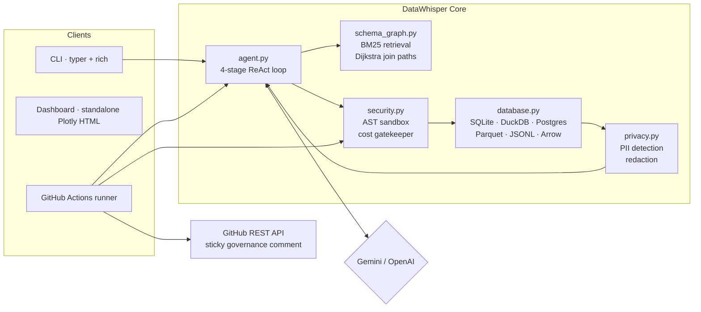
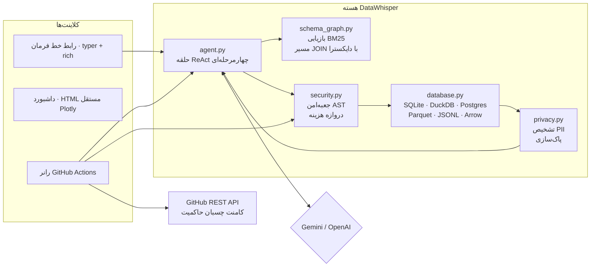

# DataWhisper v1.2

DataWhisper answers questions about your data and reviews database changes in pull requests.

It runs locally, works across SQLite, DuckDB, PostgreSQL, Parquet and JSONL, and treats the language model as untrusted: the model proposes SQL, while validation, cost limits and data masking stay in code you can read.

**Current release: 1.2.1.**

[](https://github.com/Green-tero/datawhisper/actions/workflows/ci.yml)


**Language / زبان:** open a section below. English is open by default.

<details open>
<summary><b>🇬🇧 &nbsp;English</b></summary>

<br>

**Contents:** [What it does](#what-it-does) · [What's new in 1.2](#whats-new-in-12) · [Architecture](#architecture) · [Security model](#security-model) · [Engines](#supported-engines) · [Quickstart](#quickstart) · [60-second demo](#try-it-in-60-seconds) · [Commands](#commands) · [GitHub Action](#using-it-as-a-github-action) · [Configuration](#configuration) · [Benchmarks](#benchmarks) · [Development](#development) · [License](#license)

## What it does

**1. A local analysis tool.** Ask a question about a dataset. DataWhisper prunes a large schema down to the relevant tables and join paths, writes SQL, runs it behind an AST sandbox and a cost gate, repairs its own errors, and scrubs sensitive values before showing you anything.

**2. A pull-request reviewer.** On a PR that touches SQL, migrations or data files, the bot reports column-level schema drift, flags newly introduced PII columns, detects plan regressions (an index lost to a sequential scan) and latency drift, then updates one sticky comment. A full interactive Plotly report is uploaded as an artifact.

No LangChain, no LlamaIndex. The agent is a small ReAct loop in plain Python; every model-produced statement is checked as an AST and passed through an EXPLAIN-based cost gate before execution.

## What's new in 1.2
| Area | Before | 1.2 |
| --- | --- | --- |
| Large schemas | full DDL in the prompt | BM25 retrieval + FK graph + Dijkstra join paths, token-budgeted |
| Data movement | row lists | native Arrow tables from DuckDB; lazy materialization elsewhere |
| Engines | SQLite, DuckDB, CSV | + PostgreSQL, Parquet, JSONL/NDJSON (vectorized JSON) |
| Cost control | timeout + row cap | + EXPLAIN gate: rejects cartesian joins, forces LIMIT on large scans |
| Privacy | — | PII detection and redaction before LLM, terminal and PR comment |
| PR audit | drift + latency | + PII exposure and query-plan regressions |
| Dashboards | inventory charts | auto-detected timeseries, distributions, correlations, plan view, redaction badges |

## Architecture



### The four-stage pipeline

1. **Sub-schema retrieval.** Tables are scored with Okapi BM25 over table and column identifiers. The top-K seeds are connected with a Prim-style expansion over foreign-key edges (multi-source Dijkstra), and wide tables are compressed to query-relevant columns plus primary/foreign keys. Only that sub-schema enters the prompt, within a token budget.
2. **Query generation.** The model writes SQL in the engine's dialect. `transpile_sql` validates under the source dialect *before* transpiling to another target, so cross-dialect parsing differences cannot smuggle blocked constructs.
3. **Guardrails and execution.** The AST sandbox runs first; the planner is consulted next; then the statement executes under a wall-clock timeout with a row cap in a single-worker pool.
4. **Synthesis.** Results are scrubbed, then summarized. Every ReAct turn is retained as telemetry for the dashboard and CI logs.

## Security model

### AST sandbox (`core/security.py`)

| Layer | Enforcement |
| --- | --- |
| Lexical | No semicolons and no comment tokens. Strict by design: applies even inside string literals, removing a class of parser-differential bypasses. |
| Structural | Exactly one statement; root must be `SELECT`, a set operation, a subquery, or `EXPLAIN` — a whitelist, not a blacklist. |
| Semantic | Blocks mutating nodes anywhere in the tree (including under a CTE), file readers (`read_csv`, `read_parquet`, …), extension loaders, `getenv`, `COPY`, `INSTALL`, `ATTACH`, PostgreSQL server-side readers (`pg_read_file`, `dblink`, `pg_sleep`), and catalog-qualified escapes (`secret_db.main.t`). |

Dangerous DuckDB table functions parse to *typed* nodes (`read_csv` → `ReadCSV`) whose `.name` is the argument, so the guard matches both the anonymous call name and the snake-cased node class.

### Cost gatekeeper

Before execution, `EXPLAIN`/`EXPLAIN QUERY PLAN` is normalized into a common plan model.

- **Cartesian joins are rejected.** Detection is AST-based (tables combined without any connecting predicate in that query scope), so it works on every engine, with a planner cross-check for `CROSS_PRODUCT`.
- **Large scans are paginated.** If the estimated scan exceeds `DW_MAX_SCAN_ROWS` and no tighter bound exists, a `LIMIT` is injected and the rewrite is re-validated.
- **Already-bounded scans are allowed** with an explicit note, because refusing a `LIMIT 10` query would be surprising.
- **Planner failures** follow `DW_PLAN_FAILURE_POLICY` (`allow_with_budget` by default, because the hard timeout and row cap remain in force; set `reject` for fail-closed behavior).

### PII scrubber (`core/privacy.py`)

Detection combines column semantics (a column named `email` is sensitive even when one sample does not match) with value patterns: emails, Luhn-validated card numbers, SSNs, formatted phone numbers, provider API keys (`sk-…`, `AKIA…`, `ghp_…`, `AIza…`) and JWTs.

| Mode | Output example |
| --- | --- |
| `hash` (default) | `email_9f2c…` — HMAC-SHA256 with `DW_PII_SALT`, stable across CI runs |
| `mask` | `a***@example.com`, `**** **** **** 1111` |
| `tokenize` | `<EMAIL:1>` — stable within one run |
| `redact` | `[REDACTED:EMAIL]` |

Invariants: scrubbing happens inside the execution engine, so every consumer (LLM context, terminal, dashboard, PR comment) receives scrubbed rows; the telemetry report contains counts and column names only, never values; `DW_PII_ALLOW_COLUMNS` is the single explicit opt-out.

> Honest trade-off: for Parquet/JSONL sources the engine registers a DuckDB view, which is evaluated lazily, so DuckDB filesystem access cannot be globally disabled without materializing the file. Zero-trust is enforced one level up: user SQL never reaches a file function, and only the engine-registered view is exposed. `.duckdb` files are opened `read_only=True`; SQLite is opened `mode=ro` with `query_only`; PostgreSQL runs in a read-only transaction with `statement_timeout`.

## Supported engines

| Source | Driver | Dialect | Notes |
| --- | --- | --- | --- |
| `.sqlite`, `.db`, `.sqlite3` | stdlib `sqlite3` | sqlite | `mode=ro` + `query_only` |
| `.duckdb` | `duckdb` extra | duckdb | `read_only=True` |
| `.parquet`, `.pq`, directory | DuckDB view | duckdb | native Arrow transfer |
| `.jsonl`, `.ndjson` | DuckDB `read_json_auto` | duckdb | vectorized nested extraction |
| `.csv` | DuckDB, SQLite fallback | duckdb/sqlite | typed ingest when DuckDB absent |
| `postgres://…` | `psycopg` extra | postgres | read-only transaction, server-side timeout |

## Quickstart

Requires **Python 3.11+**. DataWhisper is installed from this repository (not on PyPI):

```bash
git clone https://github.com/Green-tero/datawhisper.git
cd datawhisper

pip install -e ".[duckdb,arrow]"     # add ,postgres and ,llm as needed
poetry install --with dev --extras "duckdb arrow"   # developer setup
```

| Extra | Adds |
| --- | --- |
| `duckdb` | DuckDB engine, Parquet and JSONL sources |
| `arrow` | PyArrow zero-copy transfer (+ Polars conversion) |
| `postgres` | PostgreSQL driver |
| `llm` | Gemini and OpenAI SDKs |

```bash
export GEMINI_API_KEY=...     # or OPENAI_API_KEY=...
```

## Try it in 60 seconds

```bash
python - <<'PY'
import sqlite3
db = sqlite3.connect("demo.sqlite")
db.executescript("""
CREATE TABLE customers (id INTEGER PRIMARY KEY, name TEXT, email TEXT, country TEXT);
CREATE TABLE orders (id INTEGER PRIMARY KEY, customer_id INTEGER REFERENCES customers(id),
                     amount REAL, status TEXT, placed_at TEXT);
INSERT INTO customers VALUES (1,'Ada','ada@example.com','UK'),(2,'Alan','alan@example.com','UK'),
                             (3,'Maryam','m@example.org','IR'),(4,'Grace',NULL,'US');
INSERT INTO orders VALUES (1,1,120.5,'paid','2024-05-01'),(2,1,35.0,'paid','2024-05-02'),
                          (3,2,89.9,'pending','2024-05-03'),(4,2,NULL,'refunded','2024-05-04'),
                          (5,3,250.0,'paid','2024-05-05'),(6,4,64.0,'pending','2024-05-06');
""")
db.commit()
PY

# what the model would see — no model call, no SQL executed
datawhisper inspect --db demo.sqlite --graph "revenue per customer country"

# sandbox + cost verdict for a cartesian join (rejected, non-zero exit)
datawhisper explain "SELECT * FROM customers, orders" --db demo.sqlite

# auto-detected charts, plan view and redaction badges
datawhisper dashboard --db demo.sqlite --sql "SELECT * FROM orders" -o report.html

# with an API key: full agentic analysis
datawhisper ask "which country generates the most refund risk?" --db demo.sqlite
```

## Commands

| Command | Purpose |
| --- | --- |
| `datawhisper ask "<q>" --db <src> [--explain-only]` | Agentic analysis. `--explain-only` prints the pruned context and exits. |
| `datawhisper inspect --db <src> [--profile t.c] [--graph "<q>"]` | Catalog, column statistics, or schema-pruning preview. |
| `datawhisper explain "<sql>" --db <src>` | Dry run: AST verdict + normalized plan + cost decision. |
| `datawhisper dashboard --db <src> [-o out.html] [--sql …] [--question …]` | Standalone dark-mode report. |
| `datawhisper audit --base-sql a.sql --head-sql b.sql --dry-run` | Offline drift + PII audit. |
| `datawhisper audit --repo o/r --pr N --base-ref main --head-ref SHA --ci-audit` | Headless PR governance; posts a sticky comment. |

Exit codes: `0` success, `1` findings under `--fail-on-regression` / `--fail-on-pii` or a failed agent run, `2` configuration/security/API errors.

## Using it as a GitHub Action

Copy [`.github/workflows/datawhisper-audit.yml`](.github/workflows/datawhisper-audit.yml). It triggers on PRs touching `*.sql`, `*.sqlite`, `*.duckdb`, `*.parquet`, `*.jsonl`, `migrations/**`, `db/**`, `seeds/**`.

| Secret | Required | Purpose |
| --- | --- | --- |
| `GEMINI_API_KEY` / `OPENAI_API_KEY` | No | Agentic insights. Without it, drift/PII/plan checks still run. |
| `DW_PII_SALT` | No | Stable hash salt for pseudonyms across CI runs. |

`GITHUB_TOKEN` is provided automatically. The report is one comment marked `<!-- datawhisper:audit -->`, with collapsible sections for drift, PII exposure, plan/benchmark results and insights.

Plan regression signals are deliberately narrow to avoid alert fatigue: an index lookup that became a sequential scan, a >2× growth in estimated scanned rows above 1,000, a newly introduced cross product, or a query that now fails on one snapshot.

> The audit workflow only runs on data-file pull requests, so it stays quiet on `main`. That is expected.

## Configuration

| Variable | Default | Meaning |
| --- | --- | --- |
| `GEMINI_API_KEY` / `OPENAI_API_KEY` | none | Provider credentials (Gemini is detected first) |
| `DW_LLM_PROVIDER`, `DW_LLM_MODEL` | auto | Provider override and model id |
| `DW_QUERY_TIMEOUT` | `10` | Per-statement wall clock (seconds) |
| `DW_MAX_ROWS` | `1000` | Hard row cap per result |
| `DW_MAX_REPAIRS` | `3` | Self-healing attempts before abort |
| `DW_COST_ENABLED` | `true` | Enable the EXPLAIN gate |
| `DW_MAX_SCAN_ROWS` | `5000000` | Scan budget before forcing pagination |
| `DW_AUTO_LIMIT` | `500` | LIMIT injected for oversized scans |
| `DW_REJECT_CARTESIAN` | `true` | Reject cartesian joins |
| `DW_PLAN_FAILURE_POLICY` | `allow_with_budget` | `allow_with_budget` or `reject` |
| `DW_PII_ENABLED`, `DW_PII_MODE` | `true`, `hash` | Scrubber switch and mode |
| `DW_PII_SALT` | local default | HMAC salt; set a secret in CI |
| `DW_PII_ALLOW_COLUMNS` | empty | Comma-separated columns exempt from scrubbing |
| `DW_GRAPH_MAX_TABLES` | `6` | Tables retained per question |
| `DW_GRAPH_MAX_COLUMNS` | `12` | Column cap per table in the prompt |
| `DW_GRAPH_MAX_TOKENS` | `1500` | Prompt budget for schema context |

## Benchmarks

Measured on the development machine (Windows, Python 3.15, SQLite in memory) at this commit. These are synthetic microbenchmarks, not production throughput claims:

| Operation | Input | Median |
| --- | --- | --- |
| Schema retrieval (BM25 + Dijkstra) | 60-table FK chain | **0.72 ms** |
| AST validation | join + aggregate + LIMIT | **0.39 ms** |
| PII scrubbing | 10,000 cells across 5 columns | **28.9 ms** |
| Full test suite | 123 tests | ~1.6 s |

Reproduce the graph number:

```bash
python - <<'PY'
import statistics, time
from tests.conftest import make_large_catalog
from datawhisper.core.schema_graph import SchemaGraph

graph = SchemaGraph(make_large_catalog(60))
samples = []
for _ in range(200):
    start = time.perf_counter()
    graph.retrieve("metric value for t42 joined to t7", top_k=6)
    samples.append((time.perf_counter() - start) * 1000)
print(f"median {statistics.median(samples):.2f} ms")
PY
```

Query-latency regression testing is a separate, repository-specific exercise: provide two database snapshots and a suite of representative queries.

```bash
datawhisper audit --base-sql schema.sql --head-sql schema.sql \
  --baseline-db old.sqlite --candidate-db new.sqlite \
  --bench-file benchmarks/queries.sql --fail-on-regression
```

## Design notes

The model is treated as an untrusted component, not an oracle. It may propose SQL, but nothing runs until the statement passes the AST sandbox, the planner budget and the scrubber. The same constraint shapes schema retrieval: rather than hoping a large prompt surfaces the right table, the selection step is explicit and testable.

Two choices are deliberate. Comments and semicolons are rejected even inside string literals, because parser differences are a genuine bypass class. And when a planner is unavailable, the default is to continue under hard timeouts instead of rejecting every query; set `DW_PLAN_FAILURE_POLICY=reject` if your environment requires fail-closed behavior.

## Development

```bash
poetry install --with dev --extras "duckdb arrow"
pre-commit install
poetry run pytest -v          # 123 tests
poetry run ruff check .
poetry run black --check .
poetry run mypy datawhisper   # strict
```

Test coverage highlights: 22 injection/bypass vectors, cartesian and scan-budget gate behavior, Luhn/SSN/phone/API-key/JWT detection, zero-leak assertions on engine output and profile top values, 60-table BM25 retrieval and 35-hop pathfinding, multi-engine execution (SQLite, DuckDB, Parquet, JSONL), and self-correction after security, cost and driver failures.

## License

Apache-2.0. See [LICENSE](LICENSE).

</details>

<details>
<summary><b>🇮🇷 &nbsp;فارسی</b></summary>

<br>

<div dir="rtl">

**فهرست:** [این پروژه چه کار می‌کند](#این-پروژه-چه-کار-می-کند) · [تازه‌های نسخه ۱.۲](#تازه-های-نسخه-۱۲) · [معماری](#معماری) · [مدل امنیتی](#مدل-امنیتی) · [موتورها](#موتورهای-پشتیبانی‌شده) · [راه‌اندازی](#راه-اندازی-سریع) · [دموی ۶۰ ثانیه‌ای](#دموی-۶۰-ثانیه-ای) · [دستورات](#دستورات) · [اکشن گیت‌هاب](#استفاده-به-عنوان-github-action) · [تنظیمات](#تنظیمات) · [بنچمارک](#بنچمارک) · [توسعه](#توسعه) · [مجوز](#مجوز)

## این پروژه چه کار می‌کند

**۱. ابزار تحلیل لوکال.** یک سؤال درباره‌ی داده بپرسید. دیتاویسپر اسکیمای بزرگ را به جدول‌ها و مسیرهای JOIN مرتبط محدود می‌کند، SQL می‌نویسد، آن را پشت جعبه‌امن AST و دروازه‌ی هزینه اجرا می‌کند، خطاهای خودش را اصلاح می‌کند و پیش از نمایش، مقادیر حساس را پاک می‌کند.

**۲. ناظر Pull Request.** روی PRهایی که SQL، مهاجرت یا فایل داده را تغییر می‌دهند، بات دریفت اسکیما در سطح ستون، ستون‌های حساس تازه‌معرفی‌شده، افت کارایی پلن (تبدیل جست‌وجوی ایندکس به اسکن کامل) و کندی کوئری‌ها را گزارش می‌کند و یک کامنت چسبان را به‌روز می‌کند. گزارش تعاملی Plotly هم به‌صورت artifact بارگذاری می‌شود.

**نسخه فعلی: ۱.۲.۱.**

خبری از LangChain یا LlamaIndex نیست. عامل یک حلقه‌ی ReAct کوچک با پایتون ساده است و هر دستور تولیدشده توسط مدل، پیش از اجرا از بررسی AST و دروازه‌ی هزینه مبتنی بر EXPLAIN عبور می‌کند.

## تازه‌های نسخه ۱.۲

| حوزه | پیش از این | ۱.۲ |
| --- | --- | --- |
| اسکیمای بزرگ | کل DDL در prompt | بازیابی BM25 + گراف FK + مسیر JOIN با دایکسترا و بودجه توکن |
| انتقال داده | لیست ردیف | جدول بومی Arrow از DuckDB و مادی‌سازی تنبل در بقیه |
| موتورها | SQLite، DuckDB، CSV | + PostgreSQL، Parquet، JSONL/NDJSON با استخراج برداری JSON |
| کنترل هزینه | تایم‌اوت و سقف ردیف | + دروازه EXPLAIN: رد JOIN دکارتی و تزریق LIMIT روی اسکن بزرگ |
| حریم خصوصی | — | تشخیص و پاک‌سازی PII پیش از رسیدن به LLM، ترمینال و کامنت PR |
| ممیزی PR | دریفت + تأخیر | + ریسک PII و افت پلن کوئری |
| داشبورد | نمودار موجودی | سری زمانی، توزیع، همبستگی، نمایش پلن و نشان‌های پاک‌سازی به‌صورت خودکار |

## معماری

</div>



<div dir="rtl">

### خط لوله‌ی چهارمرحله‌ای

۱. **بازیابی زیراسکیما.** جدول‌ها با BM25 روی نام جدول و ستون امتیاز می‌گیرند. K جدول برتر با گسترش Prim روی یال‌های کلید خارجی (دایکسترای چندمبدأ) به هم متصل می‌شوند و جدول‌های پهن به ستون‌های مرتبط به‌علاوه‌ی کلیدها فشرده می‌شوند. فقط همین زیراسکیما با بودجه‌ی توکن وارد prompt می‌شود.

۲. **تولید کوئری.** مدل SQL را با دیالکت موتور می‌نویسد. تابع `transpile_sql` ابتدا تحت دیالکت مبدأ اعتبارسنجی می‌کند و سپس به مقصد ترجمه می‌کند تا تفاوت پارسرها راه فرار نشود.

۳. **دروازه و اجرا.** ابتدا جعبه‌امن AST، سپس پلن‌گیر، و در پایان اجرا با تایم‌اوت و سقف ردیف در یک نخ کارگر.

۴. **جمع‌بندی.** نتایج پاک‌سازی و سپس خلاصه می‌شوند. همه‌ی نوبت‌های ReAct برای داشبورد و لاگ CI نگه‌داری می‌شوند.

## مدل امنیتی

### جعبه‌امن AST

| لایه | قاعده |
| --- | --- |
| واژگانی | بدون سمی‌کالن و بدون توکن کامنت؛ حتی داخل رشته‌های متنی. این سخت‌گیری یک دسته حمله‌ی تفاوت پارسر را حذف می‌کند. |
| ساختاری | دقیقاً یک دستور؛ ریشه باید `SELECT`، عملگر مجموعه‌ای، زیرکوئری یا `EXPLAIN` باشد — فهرست‌سفید، نه فهرست‌سیاه. |
| معنایی | مسدودسازی گره‌های تغییردهنده در هر عمق (حتی زیر CTE)، توابع خواندن فایل (`read_csv`، `read_parquet`)، بارگذاری اکستنشن، `getenv`، `COPY`، `INSTALL`، `ATTACH`، توابع سمت سرور PostgreSQL (`pg_read_file`، `dblink`، `pg_sleep`) و فرار کاتالوگی مثل `secret_db.main.t`. |

توابع جدولی خطرناک DuckDB به گره‌ی تایپ‌دار تبدیل می‌شوند (`read_csv` → `ReadCSV`) که نامش آرگومان است؛ بنابراین بررسی هم نام فراخوانی و هم نام کلاس snake_case را می‌پوشاند.

### دروازه‌ی هزینه

پیش از اجرا، خروجی `EXPLAIN` به یک مدل پلن یکسان تبدیل می‌شود.

- **JOIN دکارتی رد می‌شود.** تشخیص مبتنی بر AST است (جدول‌هایی که در همان دامنه‌ی کوئری هیچ شرط اتصالی ندارند)، پس روی همه‌ی موتورها کار می‌کند.
- **اسکن بزرگ صفحه‌بندی می‌شود.** اگر اسکن برآوردی از `DW_MAX_SCAN_ROWS` بیشتر باشد و محدودیت tighter وجود نداشته باشد، `LIMIT` تزریق و دوباره اعتبارسنجی می‌شود.
- **کوئری از قبل محدود** با ذکر دلیل مجاز است؛ رد کردن یک `LIMIT 10` غیرمنتظره بود.
- **خطای پلن‌گیر** تابع `DW_PLAN_FAILURE_POLICY` است؛ پیش‌فرض `allow_with_budget` چون تایم‌اوت و سقف ردیف همچنان برقرارند. برای رفتار کاملاً fail-closed مقدار `reject` بگذارید.

### پاک‌سازی PII

تشخیص، دو نشانه را ترکیب می‌کند: معنای ستون (ستونی به نام `email` حتی با یک نمونه‌ی بی‌خطر حساس است) و الگوی مقدار (ایمیل، شماره کارت معتبر با الگوریتم لان، SSN، تلفن قالبی، کلیدهای API مثل `sk-…`، `AKIA…`، `ghp_…` و JWT).

| حالت | نمونه خروجی |
| --- | --- |
| `hash` (پیش‌فرض) | `email_9f2c…` — HMAC-SHA256 با `DW_PII_SALT`، پایدار بین اجراهای CI |
| `mask` | `a***@example.com`، `**** **** **** 1111` |
| `tokenize` | `<EMAIL:1>` — پایدار در یک اجرا |
| `redact` | `[REDACTED:EMAIL]` |

تضمین‌ها: پاک‌سازی داخل موتور اجرا انجام می‌شود، پس همه‌ی مصرف‌کننده‌ها (context مدل، ترمینال، داشبورد، کامنت PR) فقط ردیف پاک‌شده می‌بینند؛ گزارش تلمتری فقط شمارش و نام ستون دارد و هیچ مقدار خامی ندارد؛ `DW_PII_ALLOW_COLUMNS` تنها راه استثنا است.

> معامله‌ی صادقانه: برای منابع Parquet/JSONL موتور یک view در DuckDB می‌سازد که تنبل ارزیابی می‌شود، پس نمی‌توان دسترسی فایل DuckDB را بدون مادی‌سازی کل فایل غیرفعال کرد. zero-trust یک لایه بالاتر اعمال می‌شود: SQL کاربر هرگز به توابع فایل نمی‌رسد و فقط همان view ثبت‌شده در دسترس است. فایل `.duckdb` با `read_only=True`، SQLite با `mode=ro` و `query_only` و PostgreSQL در تراکنش فقط-خواندنی با `statement_timeout` اجرا می‌شود.

## موتورهای پشتیبانی‌شده

| منبع | درایور | دیالکت | توضیح |
| --- | --- | --- | --- |
| `.sqlite`, `.db` | `sqlite3` استاندارد | sqlite | `mode=ro` + `query_only` |
| `.duckdb` | اکسترای `duckdb` | duckdb | `read_only=True` |
| `.parquet` و دایرکتوری | view در DuckDB | duckdb | انتقال بومی Arrow |
| `.jsonl`, `.ndjson` | `read_json_auto` | duckdb | استخراج برداری داده‌ی تودرتو |
| `.csv` | DuckDB، با جایگزین SQLite | duckdb/sqlite | نوع‌دهی هنگام نبود DuckDB |
| `postgres://…` | اکسترای `postgres` | postgres | تراکنش فقط-خواندنی و تایم‌اوت سمت سرور |

## راه‌اندازی سریع

به **پایتون ۳.۱۱ یا بالاتر** نیاز دارید. نصب از همین مخزن انجام می‌شود (هنوز روی PyPI نیست):

</div>

```bash
git clone https://github.com/Green-tero/datawhisper.git
cd datawhisper

pip install -e ".[duckdb,arrow]"     # در صورت نیاز ,postgres و ,llm
poetry install --with dev --extras "duckdb arrow"   # محیط توسعه
```

<div dir="rtl">

| اکسترا | چه اضافه می‌کند |
| --- | --- |
| `duckdb` | موتور DuckDB و منابع Parquet و JSONL |
| `arrow` | انتقال zero-copy با PyArrow و تبدیل Polars |
| `postgres` | درایور PostgreSQL |
| `llm` | کیت‌های Gemini و OpenAI |

</div>

```bash
export GEMINI_API_KEY=...     # or OPENAI_API_KEY=...
```

<div dir="rtl">

## دموی ۶۰ ثانیه‌ای

</div>

```bash
python - <<'PY'
import sqlite3
db = sqlite3.connect("demo.sqlite")
db.executescript("""
CREATE TABLE customers (id INTEGER PRIMARY KEY, name TEXT, email TEXT, country TEXT);
CREATE TABLE orders (id INTEGER PRIMARY KEY, customer_id INTEGER REFERENCES customers(id),
                     amount REAL, status TEXT, placed_at TEXT);
INSERT INTO customers VALUES (1,'Ada','ada@example.com','UK'),(2,'Alan','alan@example.com','UK'),
                             (3,'Maryam','m@example.org','IR'),(4,'Grace',NULL,'US');
INSERT INTO orders VALUES (1,1,120.5,'paid','2024-05-01'),(2,1,35.0,'paid','2024-05-02'),
                          (3,2,89.9,'pending','2024-05-03'),(4,2,NULL,'refunded','2024-05-04'),
                          (5,3,250.0,'paid','2024-05-05'),(6,4,64.0,'pending','2024-05-06');
""")
db.commit()
PY

# آنچه مدل می‌بیند؛ بدون فراخوانی مدل و بدون اجرای SQL
datawhisper inspect --db demo.sqlite --graph "revenue per customer country"

# حکم جعبه‌امن و دروازه هزینه برای JOIN دکارتی (رد می‌شود، خروج غیرصفر)
datawhisper explain "SELECT * FROM customers, orders" --db demo.sqlite

# نمودارهای خودکار، نمایش پلن و نشان‌های پاک‌سازی
datawhisper dashboard --db demo.sqlite --sql "SELECT * FROM orders" -o report.html

# با کلید API: تحلیل کامل عاملی
datawhisper ask "which country generates the most refund risk?" --db demo.sqlite
```

<div dir="rtl">

## دستورات

| دستور | کاربرد |
| --- | --- |
| `datawhisper ask "<سؤال>" --db <src> [--explain-only]` | تحلیل عاملی؛ `--explain-only` فقط context هرس‌شده را نشان می‌دهد. |
| `datawhisper inspect --db <src> [--profile t.c] [--graph "<سؤال>"]` | کاتالوگ، آمار ستون یا پیش‌نمایش هرس اسکیما. |
| `datawhisper explain "<sql>" --db <src>` | اجرای آزمایشی: حکم AST + پلن نرمال‌شده + تصمیم هزینه. |
| `datawhisper dashboard --db <src> [-o out.html]` | گزارش مستقل حالت تاریک. |
| `datawhisper audit --base-sql a.sql --head-sql b.sql --dry-run` | ممیزی آفلاین دریفت و PII. |
| `datawhisper audit --repo o/r --pr N --base-ref main --ci-audit` | حاکمیت PR به‌صورت headless و ثبت کامنت چسبان. |

کدهای خروج: `0` موفق، `1` یافتن مشکل با `--fail-on-regression` یا `--fail-on-pii` یا شکست عامل، `2` خطای تنظیمات/امنیت/API.

## استفاده به‌عنوان GitHub Action

فایل [`.github/workflows/datawhisper-audit.yml`](.github/workflows/datawhisper-audit.yml) را کپی کنید. روی PRهایی اجرا می‌شود که `*.sql`، `*.sqlite`، `*.duckdb`، `*.parquet`، `*.jsonl`، `migrations/**`، `db/**` یا `seeds/**` را تغییر دهند.

| Secret | اجباری | کاربرد |
| --- | --- | --- |
| `GEMINI_API_KEY` / `OPENAI_API_KEY` | خیر | تحلیل عاملی؛ بدون آن هم دریفت، PII و پلن بررسی می‌شوند. |
| `DW_PII_SALT` | خیر | نمک پایدار برای یکسان ماندن pseudonymها بین اجراها. |

توکن `GITHUB_TOKEN` خودکار است. گزارش یک کامنت با نشانگر `<!-- datawhisper:audit -->` است و بخش‌های دریفت، ریسک PII، پلن/بنچمارک و تحلیل به‌صورت جمع‌شونده نمایش داده می‌شوند.

نشانه‌های افت پلن عمداً محدودند تا هشدار بی‌مورد تولید نشود: تبدیل جست‌وجوی ایندکس به اسکن کامل، رشد بیش از دو برابری ردیف‌های اسکن‌شده بالای ۱۰۰۰، ایجاد cross product تازه، یا شکست کوئری روی یکی از نسخه‌ها.

> این workflow فقط روی PRهایی با تغییر فایل داده اجرا می‌شود، پس روی `main` ساکت است. این رفتار طبیعی است.

## تنظیمات

| متغیر | پیش‌فرض | معنی |
| --- | --- | --- |
| `GEMINI_API_KEY` / `OPENAI_API_KEY` | ندارد | اعتبارنامه؛ اول Gemini تشخیص داده می‌شود |
| `DW_LLM_PROVIDER`، `DW_LLM_MODEL` | خودکار | بازنویسی ارائه‌دهنده و مدل |
| `DW_QUERY_TIMEOUT` | `10` | محدودیت زمانی هر دستور (ثانیه) |
| `DW_MAX_ROWS` | `1000` | سقف سخت ردیف در هر نتیجه |
| `DW_MAX_REPAIRS` | `3` | تعداد تلاش خوداصلاحی |
| `DW_COST_ENABLED` | `true` | فعال‌سازی دروازه EXPLAIN |
| `DW_MAX_SCAN_ROWS` | `5000000` | بودجه اسکن پیش از صفحه‌بندی اجباری |
| `DW_AUTO_LIMIT` | `500` | مقدار LIMIT تزریقی |
| `DW_REJECT_CARTESIAN` | `true` | رد JOIN دکارتی |
| `DW_PLAN_FAILURE_POLICY` | `allow_with_budget` | `allow_with_budget` یا `reject` |
| `DW_PII_ENABLED`، `DW_PII_MODE` | `true`، `hash` | کلید و حالت پاک‌سازی |
| `DW_PII_SALT` | پیش‌فرض محلی | نمک HMAC؛ در CI به‌صورت secret |
| `DW_PII_ALLOW_COLUMNS` | خالی | ستون‌های معاف از پاک‌سازی |
| `DW_GRAPH_MAX_TABLES` | `6` | تعداد جدول نگه‌داشته‌شده برای هر سؤال |
| `DW_GRAPH_MAX_COLUMNS` | `12` | سقف ستون هر جدول در prompt |
| `DW_GRAPH_MAX_TOKENS` | `1500` | بودجه توکن context اسکیما |

## بنچمارک

اندازه‌گیری‌شده روی ماشین توسعه (ویندوز، پایتون ۳.۱۵، SQLite در حافظه) در همین commit. این‌ها میکروبنچمارک مصنوعی‌اند، نه ادعای throughput تولیدی:

| عملیات | ورودی | میانه |
| --- | --- | --- |
| بازیابی اسکیما (BM25 + دایکسترا) | زنجیره ۶۰ جدولی FK | **۰.۷۲ میلی‌ثانیه** |
| اعتبارسنجی AST | join + aggregate + LIMIT | **۰.۳۹ میلی‌ثانیه** |
| پاک‌سازی PII | ۱۰٬۰۰۰ سلول در ۵ ستون | **۲۸.۹ میلی‌ثانیه** |
| کل تست‌ها | ۱۲۳ تست | حدود ۱.۶ ثانیه |

بازتولید عدد گراف:

</div>

```bash
python - <<'PY'
import statistics, time
from tests.conftest import make_large_catalog
from datawhisper.core.schema_graph import SchemaGraph

graph = SchemaGraph(make_large_catalog(60))
samples = []
for _ in range(200):
    start = time.perf_counter()
    graph.retrieve("metric value for t42 joined to t7", top_k=6)
    samples.append((time.perf_counter() - start) * 1000)
print(f"median {statistics.median(samples):.2f} ms")
PY
```

<div dir="rtl">

تست رگرسیون تأخیر کوئری موضوعی جدا و وابسته به مخزن است: دو نسخه دیتابیس و مجموعه‌ای از کوئری‌های نماینده تهیه کنید.

</div>

```bash
datawhisper audit --base-sql schema.sql --head-sql schema.sql \
  --baseline-db old.sqlite --candidate-db new.sqlite \
  --bench-file benchmarks/queries.sql --fail-on-regression
```

<div dir="rtl">

## یادداشت طراحی

مدل یک مؤلفه‌ی غیرقابل‌اعتماد است، نه یک مرجع. می‌تواند SQL پیشنهاد بدهد، اما تا وقتی دستور از جعبه‌امن AST، بودجه‌ی پلن‌گیر و پاک‌ساز عبور نکند اجرا نمی‌شود. همین محدودیت، بازیابی اسکیما را هم شکل می‌دهد: به‌جای امید به یک prompt بزرگ، انتخاب جدول‌ها صریح و قابل تست است.

دو انتخاب عمدی است. کامنت و سمی‌کالن حتی داخل رشته‌های متنی رد می‌شوند، چون تفاوت پارسرها یک دسته‌ی واقعی دورزدن است. و وقتی پلن‌گیر در دسترس نیست، پیش‌فرض ادامه با تایم‌اوت سخت است، نه رد همه‌ی کوئری‌ها؛ اگر محیط شما fail-closed می‌خواهد، `DW_PLAN_FAILURE_POLICY=reject` بگذارید.

## توسعه

</div>

```bash
poetry install --with dev --extras "duckdb arrow"
pre-commit install
poetry run pytest -v          # ۱۲۳ تست
poetry run ruff check .
poetry run black --check .
poetry run mypy datawhisper   # سخت‌گیرانه
```

<div dir="rtl">

پوشش تست‌ها: ۲۲ بردار تزریق/فرار، رفتار دروازه برای JOIN دکارتی و بودجه اسکن، تشخیص ایمیل/کارت با لان/SSN/تلفن/کلید API/JWT، تضمین نشت‌صفر روی خروجی موتور و مقادیر پرتکرار پروفایل، بازیابی BM25 روی ۶۰ جدول و مسیر ۳۵ گامی، اجرای چندموتوری (SQLite، DuckDB، Parquet، JSONL) و خوداصلاحی پس از خطای امنیتی، هزینه و درایور.

## مجوز

Apache-2.0. فایل [LICENSE](LICENSE) را ببینید.

</div>

</details>
