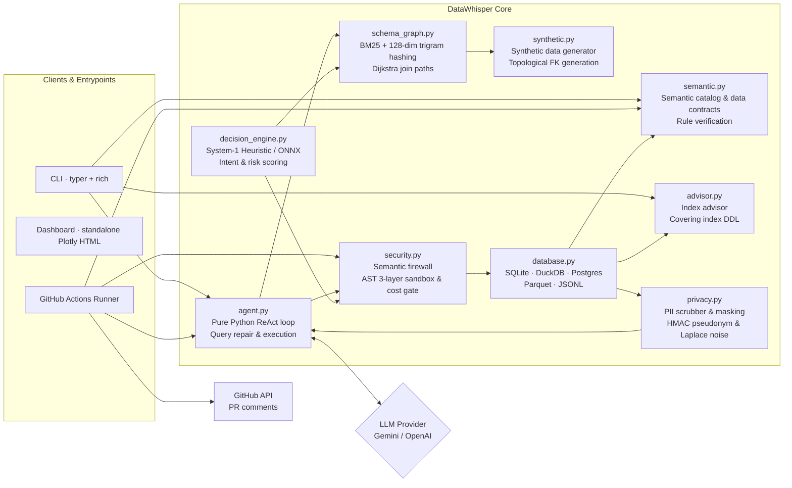

# DataWhisper v1.5.9

DataWhisper is a local data analysis tool and CI/CD pull request auditor for relational databases and columnar files.

It runs locally against SQLite, DuckDB, PostgreSQL, Parquet, and JSONL. It treats language models as untrusted: the model drafts SQL, while syntax validation, execution limits, data contracts, and data masking remain in deterministic code you can inspect.

[](https://github.com/Green-tero/datawhisper/actions/workflows/ci.yml)


**Persian docs:** [docs/README.fa.md](docs/README.fa.md) · **Configuration reference:** [docs/configuration.md](docs/configuration.md) · **Changelog:** [CHANGELOG.md](CHANGELOG.md)

---

## What it does

1. **Natural-language data analysis under zero-trust assumptions:** Ask analytical questions about your database. DataWhisper classifies intent and filters large schemas down to candidate tables using BM25 and 128-dimensional character-trigram feature hashing. It drafts SQL with a local or remote model, verifies the AST, checks the query execution plan with a cost gate, repairs driver errors, and masks sensitive values before returning data.
2. **CI/CD migration and schema review:** On pull requests changing SQL migrations or schemas, DataWhisper diffs DDL, flags newly added sensitive columns, catches execution plan regressions (such as an index scan turning into a table scan), checks for migration lock risks and missing foreign-key indexes, and posts sticky summary reports to the pull request.
3. **Runtime data contracts:** Verify business expectations (`NOT NULL`, allowed values, minimum row counts) on tables in pipelines or test suites with `datawhisper contract`.
4. **Index recommendations:** Inspect query predicates and join keys across SQLite, PostgreSQL, and DuckDB with `datawhisper advise` to identify unindexed filter columns and generate covering index statements.
5. **Synthetic test data generation:** Generate referentially integral test datasets directly from schema catalog snapshots with `SyntheticDataGenerator`, avoiding the need to copy production data into test environments.

There is no LangChain or LlamaIndex dependency. The agent loop is a small, deterministic ReAct loop in pure Python. Every statement passes through the semantic firewall, AST parser, and query planner cost gate.

---

## Architecture



---

## Supported engines

| Source | Backend | Security & Access Profile |
| ------ | ------- | ------------------------- |
| `.sqlite`, `.db` | `sqlite3` (stdlib) | Opened `mode=ro` with `query_only=ON` |
| `.duckdb` | DuckDB driver | Opened `read_only=True` |
| `.parquet`, `.pq` | DuckDB in-memory view | Read-only view; file access functions blocked at AST layer |
| `.jsonl`, `.ndjson` | DuckDB in-memory view | Vectorized JSON schema extraction |
| `.csv` | DuckDB (SQLite fallback) | Schema inference and type ingestion |
| `postgres://...` | psycopg (v3) | Read-only transaction with server-side `statement_timeout` |

---

## Quickstart

Requires **Python 3.11, 3.12, or 3.13**:

```bash
git clone https://github.com/Green-tero/datawhisper.git
cd datawhisper

# Install core package with DuckDB and Arrow support
pip install -e ".[duckdb,arrow]"

# Or install all extras for development
poetry install --with dev --extras "duckdb arrow postgres llm"
```

To configure model providers (optional for local heuristic operations):
```bash
export GEMINI_API_KEY="your-gemini-key"
# or
export OPENAI_API_KEY="your-openai-key"
```

---

## 60-second demo

```bash
# Create a sample database
python -c "
import sqlite3
c = sqlite3.connect('demo.sqlite')
c.executescript('''
CREATE TABLE customers (id INTEGER PRIMARY KEY, name TEXT, email TEXT);
CREATE TABLE orders (id INTEGER PRIMARY KEY, customer_id INTEGER, amount REAL, status TEXT);
INSERT INTO customers VALUES (1, 'Ada Lovelace', 'ada@example.com'), (2, 'Alan Turing', 'alan@example.com');
INSERT INTO orders VALUES (1, 1, 150.0, 'paid'), (2, 2, 75.0, 'pending');
''')
c.commit()
"

# 1. Inspect schema tables and columns
datawhisper inspect --source demo.sqlite

# 2. Get covering index recommendations for a query
datawhisper advise "SELECT * FROM orders WHERE status = 'paid'" --source demo.sqlite

# 3. Verify data contracts
datawhisper contract --source demo.sqlite --table customers --not-null name --min-rows 2

# 4. Check sandbox validation and query execution plan without running SQL
datawhisper explain "SELECT * FROM customers c JOIN orders o ON c.id = o.customer_id" --source demo.sqlite

# 5. Ask a question with natural language
datawhisper ask "which customers have paid orders?" --source demo.sqlite
```

*(Note: `--db` is accepted as an alias for `--source` across all commands).*

---

## CLI commands

| Command | Description |
| ------- | ----------- |
| `datawhisper ask "<question>" --source <path> [--explain-only]` | Run the agent against the database. `--explain-only` prints pruned schema context and candidate SQL without executing. |
| `datawhisper advise "<sql>" --source <path>` | Analyze query predicates and propose covering index statements with estimated cost reduction. |
| `datawhisper contract --source <path> --table <name> [rules]` | Validate table constraints (`--not-null`, `--unique`, `--min-rows`) in CI or pipeline jobs. |
| `datawhisper inspect --source <path> [--profile <table>.<col>]` | View schema catalog, profile column distributions, or test schema retrieval. |
| `datawhisper explain "<sql>" --source <path>` | Run statement through AST validation and the planner cost gate without executing. |
| `datawhisper dashboard --source <path> [-o report.html]` | Generate a standalone Plotly HTML report with distribution and correlation charts. |
| `datawhisper audit --base-sql a.sql --head-sql b.sql --dry-run` | Run offline migration audit for schema drift, lock risks, and unindexed foreign keys. |
| `datawhisper audit --repo o/r --pr N --base-ref main --head-ref SHA --ci-audit` | Run full automated review in GitHub Actions and comment on the pull request. |

---

## Security & execution guardrails

### Semantic firewall
Before parsing ASTs, a fast System-1 classifier scores statement risk in under 30 microseconds. Explicit destructive statements (`DROP`, `TRUNCATE`, unconstrained `DELETE`) and prompt-injection patterns are rejected before hitting the database or LLM.

### AST sandbox
- **Lexical:** Rejects semicolons (`;`) and comment tokens (`--`, `/* */`), even within string literals, to close parser-differential bypass vectors.
- **Structural:** Enforces a single statement root of type `SELECT`, `WITH`, or `EXPLAIN`.
- **Semantic:** Blocks arbitrary file reading (`read_csv`, `read_parquet_raw`), subprocess execution, extension loading, and Postgres administrative functions (`pg_read_file`).

### Query plan cost gate
- **Cartesian joins:** Rejects queries with disconnected join graphs (`CROSS JOIN` or multiple `FROM` tables lacking join conditions).
- **Scan limits:** Enforces row scan ceilings from execution plans and automatically injects root `LIMIT` clauses on unbounded analytical queries.

### Privacy & PII scrubbing
Scrubbing runs inside the engine before data leaves memory:
- `hash`: HMAC-SHA256 tokenization using `DW_PII_SALT`.
- `pseudonymize`: Consistent HMAC pseudonymization preserving foreign key equality across `JOIN` and `GROUP BY`.
- `differential_privacy`: Calibrated Laplace noise on aggregated numeric outputs (experimental per-query noise; no cross-query budget ledger).
- `mask`: Character masking (e.g. `a***@example.com`).
- `tokenize`: Ephemeral run tokens (e.g. `<EMAIL:1>`).
- `redact`: Static placeholder (e.g. `[REDACTED:EMAIL]`).

---

## Limitations & non-goals

- **Read-only analytics:** DataWhisper is designed for read-only querying and pull request schema auditing. Mutation operations (`INSERT`, `UPDATE`, `DELETE`, `DROP`, `ALTER`) are rejected in query mode. It is not a database administration console.
- **Not an ETL orchestrator:** DataWhisper does not transform or schedule data pipelines. Use dbt or Apache Airflow for data transformation workflows.
- **Feature hashing vs. deep embeddings:** Schema graph ranking uses BM25 alongside 128-dimensional character-trigram feature hashing. This provides fast, offline, and lightweight retrieval without requiring external vector databases or multi-gigabyte neural models.
- **Differential privacy scope:** The differential privacy mode injects Laplace noise on numeric metric values on a per-query basis. It does not implement global privacy budget tracking across recurring queries.
- **Defense in depth:** DuckDB file views rely on AST sandbox blocking for isolation. For PostgreSQL, production deployments should always use dedicated read-only database roles with server-side `statement_timeout` configured.

---

## Benchmarks

Measured on standard hardware (Windows, Python 3.15, in-memory engines):

| Operation | Component | Median Latency |
| --------- | --------- | -------------- |
| **System-1 Decision** | Intent and risk scoring | **~23 µs** |
| **Semantic Firewall** | Substring and regex rules | **~20 µs** |
| **AST Validation** | sqlglot structural parsing | **~0.77 ms** |
| **Schema Pruning** | BM25 + 128-dim trigram hashing (50 tables) | **~1.29 ms** |
| **Index Recommendation** | AST predicate extraction and DDL | **~0.35 ms** |
| **PII Scrubbing** | 10,000 cells across 4 columns (with fast-paths) | **~61 ms** |
| **Synthetic Generation** | 1,000 rows with referential integrity | **~2.94 ms** |
| **Full Test Suite** | 206 unit and integration tests | **~6.2 s** |

To reproduce these benchmarks locally:
```bash
python benchmarks/run_benchmarks.py
```

---

## Development

```bash
# Install development dependencies
poetry install --with dev --extras "duckdb arrow postgres llm"
pre-commit install

# Run quality checks
poetry run pytest -v          # 206 tests passing
poetry run ruff check .       # linting
poetry run black --check .    # code style formatting
poetry run mypy datawhisper   # strict static type check
```

---

## Documentation

- [Full Configuration Guide](docs/configuration.md) — Reference table of all environment variables (`DW_*`).
- [Persian Documentation / راهنمای فارسی](docs/README.fa.md) — Documentation in Persian.
- [Security Policy](SECURITY.md) — Security model and vulnerability reporting.
- [Contributing Guide](CONTRIBUTING.md) — Contribution guidelines and pull request workflow.

---

## License

Apache-2.0. See [LICENSE](LICENSE).
