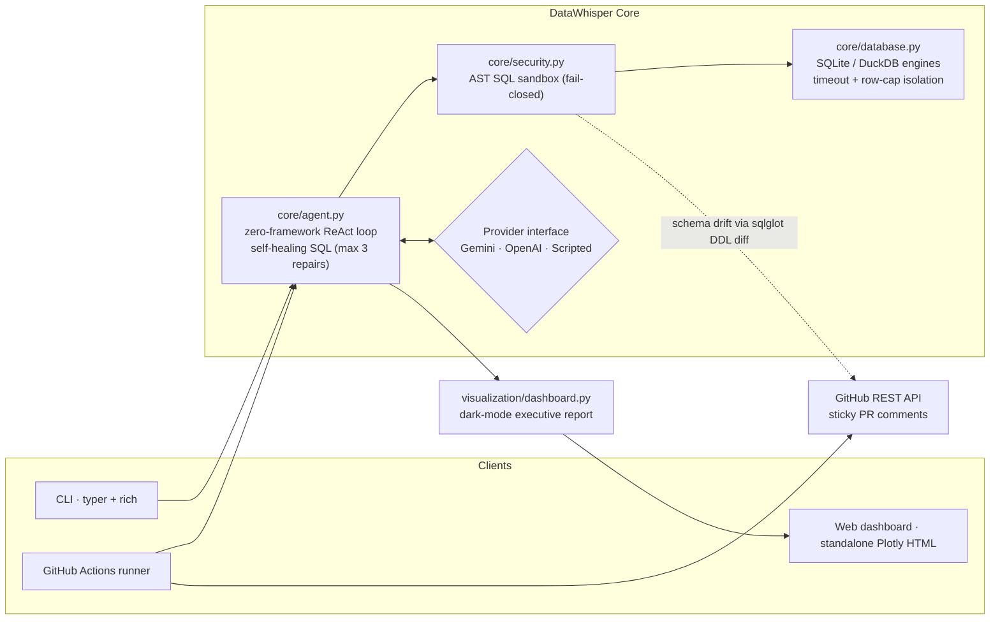

# DataWhisper

> Enterprise-grade, local-first **agentic tabular data engine** with self-correcting SQL and an autonomous **GitHub CI/CD auditor**.

[](./.github/workflows/ci.yml)
[](./.github/workflows/datawhisper-audit.yml)

DataWhisper serves a dual purpose:

1. **Local power tool** — an interactive CLI (`typer` + `rich`) and a dark-mode standalone Plotly dashboard for querying SQLite / DuckDB / CSV datasets in natural language, with a self-correcting SQL loop.
2. **GitHub CI/CD autonomous auditor** — a GitHub Action bot that inspects schema migrations on incoming Pull Requests, computes schema drift and query performance deltas, and posts an executive summary (interactive markdown tables + inline bar visualizations + a full Plotly artifact) as a *sticky* PR comment.

The agentic engine is **zero-framework**: a pure-Python ReAct loop — no LangChain, no LlamaIndex. Every model-generated SQL statement passes an **AST-level sandbox** (`sqlglot`) before it touches a driver.

---

## 🇬🇧 English Documentation

### Features

- **Self-correcting SQL loop** — driver errors are fed back to the model, which repairs the query (up to 3 attempts) and always terminates with a structured outcome.
- **Fail-closed AST sandbox** — lexical, structural and semantic layers; only a single read-only statement ever reaches a driver.
- **Unified execution engine** — SQLite, DuckDB and CSV behind one interface, with per-query timeouts, row caps and thread-isolated cancellation.
- **Column-level schema drift** — added/removed/type-changed columns and dropped tables, parsed from `CREATE TABLE` DDL.
- **Benchmarks with regression gating** — best-of-N timing on baseline versus candidate snapshots; `--fail-on-regression` gates merges.
- **Sticky PR comments** — one anchor-marked comment per PR, updated on every push instead of flooding the thread.
- **Dark-mode Plotly dashboard** — standalone exportable HTML with KPI cards, execution timeline and drift/benchmark charts.
- **Deterministic without an LLM** — CI audits still produce drift and benchmark reports when no API key is configured.

### Architecture



**Autonomous ReAct pipeline** (`core/agent.py`):

1. **Schema & anomaly discovery** — `inspect_schema` / `profile_column` tools expose tables, types, null ratios, distinct counts and top values.
2. **Query formulation & AST verification** — the model writes dialect-specific SQL (SQLite / DuckDB); the sandbox verifies it structurally before execution.
3. **Execution & self-healing loop** — statements run on a single-worker, timeout-isolated, read-only connection. Driver errors are fed back verbatim so the model repairs its SQL (max 3 repair attempts, then a structured failure report).
4. **Analytical synthesis** — a `final_answer` turn summarizes the observations with concrete numbers; every ReAct turn is retained as an audit trail (and rendered as an execution timeline).

**Security model** (`core/security.py`, fail-closed):

| Layer | Enforcement |
| --- | --- |
| Lexical | No multi-statement payloads, no comment tokens (strict policy — applies even inside string literals) |
| Structural | Single AST root must be `SELECT` / set-operation / `EXPLAIN` (whitelist, not blacklist) |
| Semantic | Blocks `PRAGMA`, `ATTACH`, `COPY`, `INSTALL`, file-reading table functions (`read_csv`, `read_parquet`, …), `load_extension`, `getenv`, and catalog-qualified escapes (`secret_db.main.t`) |

### Quickstart

```bash
# pip
pip install -e ".[duckdb,llm]"        # or: poetry install --with dev --extras duckdb

# environment (agentic layer; without a key the audit still runs deterministically)
export GEMINI_API_KEY=...             # or OPENAI_API_KEY=...
```

```bash
# Ask a question in natural language
datawhisper ask "which customers generate the most refund risk?" --db shop.sqlite

# Inspect the catalog / profile a null-heavy column
datawhisper inspect --db analytics.duckdb --profile orders.amount

# Generate a standalone dark-mode Plotly dashboard
datawhisper dashboard --db shop.sqlite --question "summarize data quality" -o report.html
```

### CLI reference

| Command | Purpose |
| --- | --- |
| `datawhisper ask "<question>" --db <file>` | Run the self-correcting agent against a dataset. |
| `datawhisper inspect --db <file> [--profile table.column]` | Print catalog, types, row counts and column statistics. |
| `datawhisper dashboard --db <file> -o report.html [--question ...]` | Render the standalone dark-mode dashboard. |
| `datawhisper audit --repo owner/name --pr N --base-ref main --head-ref SHA` | CI mode: drift + benchmarks + insights, posts a sticky PR comment. |
| `datawhisper audit --base-sql old.sql --head-sql new.sql --dry-run` | Offline drift audit of two migration snapshots. |
| `datawhisper audit ... --baseline-db a.db --candidate-db b.db --bench-file suite.sql` | Add query benchmarks to any audit. |

### GitHub Action installation

Copy [`.github/workflows/datawhisper-audit.yml`](.github/workflows/datawhisper-audit.yml) into your repository (it is already wired for self-use). Configure one optional secret:

| Secret | Required | Purpose |
| --- | --- | --- |
| `GEMINI_API_KEY` (or `OPENAI_API_KEY`) | No | Enables the agentic insight layer. Without it, audits run deterministic drift + benchmarks only. |

`GITHUB_TOKEN` is provided automatically by Actions — no configuration needed. The workflow:

- triggers on PRs touching `*.sql`, `*.sqlite`, `*.sqlite3`, `*.duckdb`, `migrations/**`, `db/**`, `seeds/**`;
- posts/updates a **sticky** audit comment (anchored by `<!-- datawhisper:audit -->`) with schema-drift tables, benchmark verdicts and unicode latency bars (GitHub strips `<script>`, so interactive charts live in the uploaded **Plotly artifact**);
- exits non-zero on `--fail-on-regression` so merges can be gated.

```yaml
- run: |
    datawhisper audit \
      --repo "${{ github.repository }}" \
      --pr "${{ github.event.pull_request.number }}" \
      --base-ref "${{ github.base_ref }}" \
      --head-ref "${{ github.event.pull_request.head.sha }}" \
      --fail-on-regression
  env:
    DATAWHISPER_GITHUB_TOKEN: ${{ secrets.GITHUB_TOKEN }}
```

Local (offline) audit of two migration snapshots:

```bash
datawhisper audit --base-sql migrations/V001__old.sql --head-sql migrations/V002__new.sql --dry-run
```

### Configuration reference

| Variable | Default | Meaning |
| --- | --- | --- |
| `GEMINI_API_KEY` / `OPENAI_API_KEY` | — | Provider credentials (auto-detect order: Gemini → OpenAI) |
| `DW_LLM_PROVIDER` | auto | `gemini` \| `openai` \| `none` |
| `DW_LLM_MODEL` | per provider | e.g. `gemini-2.0-flash`, `gpt-4o-mini` |
| `DW_QUERY_TIMEOUT` | `10` | Per-statement wall-clock budget (seconds) |
| `DW_MAX_ROWS` | `1000` | Row cap per query |
| `DW_MAX_REPAIRS` | `3` | Self-healing attempts before abort |
| `DATAWHISPER_GITHUB_TOKEN` / `GITHUB_TOKEN` | — | CI token for PR comments |

### Development

```bash
poetry install --with dev --extras duckdb
pre-commit install                 # ruff + black + mypy (strict)
poetry run pytest -v               # security penetration, self-correction, GitHub bot suites
poetry run mypy datawhisper        # strict typing gate
```

---

## 🇮🇷 مستندات فارسی

**دیتا‌ویسپر** یک موتور تحلیل داده‌ی جدولی **لوکال-محور** همراه با عامل هوشمند (Agent) است که SQL را به‌صورت خوداصلاح‌شونده اجرا می‌کند و به‌عنوان ممیز خودکار در **GitHub CI/CD** عمل می‌کند.

### ویژگی‌ها

- **حلقه SQL خوداصلاح‌شونده** — خطای درایور به مدل بازخورد داده می‌شود و کوئری اصلاح می‌شود (حداکثر ۳ تلاش) و اجرا همیشه با نتیجه ساخت‌یافته پایان می‌یابد.
- **جعبه‌امن AST با سیاست fail-closed** — سه لایه بازرسی واژگانی، ساختاری و معنایی؛ تنها یک دستور فقط-خواندنی به درایور می‌رسد.
- **موتور اجرای یکپارچه** — SQLite، DuckDB و CSV پشت یک رابط، با تایم‌اوت هر کوئری، سقف ردیف و لغو ایمن در نخ جداگانه.
- **دریفت اسکیما در سطح ستون** — ستون‌های افزوده/حذف‌شده، تغییر تایپ و جدول‌های حذف‌شده از DDL استخراج می‌شود.
- **بنچمارک کوئری با دروازه رگرسیون** — زمان‌گیری بهترین-از-N روی دو نسخه؛ `--fail-on-regression` ادغام را مسدود می‌کند.
- **کامنت چسبان روی PR** — یک کامنت لنگرگذاری‌شده که با هر push به‌روزرسانی می‌شود، بدون شلوغ کردن گفتگو.
- **داشبورد Plotly حالت تاریک** — فایل HTML مستقل با کارت‌های KPI، تایم‌لاین اجرا و نمودار دریفت و بنچمارک.
- **اجرای قطعی بدون LLM** — در نبود کلید API، گزارش دریفت و بنچمارک همچنان تولید می‌شود.

### معماری

```mermaid
flowchart RL
    subgraph کلاینت‌ها
        CLI["رابط خط فرمان · typer + rich"]
        DASH["داشبورد وب · HTML مستقل با Plotly"]
        GHA["رانر GitHub Actions"]
    end
    subgraph هسته["هسته DataWhisper"]
        SEC["security.py<br/>جعبه‌امن SQL مبتنی بر AST (fail-closed)"]
        DB["database.py<br/>موتور SQLite / DuckDB<br/>با ایزولاسیون تایم‌اوت"]
        AGENT["agent.py<br/>حلقه ReAct بدون فریم‌ورک<br/>خوداصلاحی SQL (حداکثر ۳ تلاش)"]
        PROV{"رابط مدل<br/>Gemini · OpenAI · Scripted"}
    end
    GH["GitHub REST API<br/>کامنت‌های چسبان روی PR"]
    REPORT["dashboard.py<br/>گزارش مدیریتی حالت تاریک"]
    CLI --> AGENT
    GHA --> AGENT
    AGENT --> SEC --> DB
    AGENT <--> PROV
    AGENT --> REPORT --> DASH
    GHA --> GH
```

### خط لوله عامل خودگردان

۱. **کاوش اسکیما و ناهنجاری** — فهرست جدول‌ها، تایپ‌ها، نسبت نال‌ها و مقادیر پرتکرار.
۲. **تدوین کوئری و راستی‌آزمایی AST** — تولید SQL متناسب با دیالکت (SQLite / DuckDB) و اعتبارسنجی ساختاری پیش از اجرا.
۳. **اجرا و حلقه خودترمیمی** — اجرای فقط-خواندنی با تایم‌اوت؛ در صورت خطا، پیام درایور به مدل بازگردانده می‌شود تا SQL را اصلاح کند (حداکثر ۳ بار).
۴. **تحلیل و جمع‌بندی** — پاسخ نهایی با اعداد مستند به مشاهدات ابزارها؛ تمام مراحل به‌عنوان رد حسابرسی نگهداری می‌شود.

### مدل امنیتی

هر دستور SQL پیش از رسیدن به درایور از **سه لایه** عبور می‌کند: بازرسی واژگانی (ممنوعیت چند-دستوری و کامنت)، فهرست‌سفید ساختاری (فقط `SELECT` / `WITH` / `EXPLAIN`) و پیمایش گره‌به‌گره AST (مسدودسازی `PRAGMA`، `ATTACH`، `COPY`، `INSTALL`، توابع خواندن فایل مانند `read_csv` و ارجاع به دیتابیس‌های خارجی).

### راه‌اندازی سریع

```bash
pip install -e ".[duckdb,llm]"
export GEMINI_API_KEY=...   # یا OPENAI_API_KEY

datawhisper ask "کدام مشتریان بیشترین ریسک بازپرداخت را دارند؟" --db shop.sqlite
datawhisper inspect --db shop.sqlite --profile orders.amount
datawhisper dashboard --db shop.sqlite -o report.html
```

### مرجع دستورات

| دستور | کاربرد |
| --- | --- |
| `datawhisper ask "<سؤال>" --db <file>` | اجرای عامل خوداصلاح‌شونده روی مجموعه داده. |
| `datawhisper inspect --db <file> [--profile table.column]` | نمایش کاتالوگ، تایپ‌ها، تعداد ردیف و آمار ستون. |
| `datawhisper dashboard --db <file> -o report.html` | تولید داشبورد مستقل حالت تاریک. |
| `datawhisper audit --repo owner/name --pr N --base-ref main` | حالت CI: دریفت + بنچمارک + تحلیل و ثبت کامنت چسبان. |
| `datawhisper audit --base-sql old.sql --head-sql new.sql --dry-run` | ممیزی آفلاین دو نسخه مهاجرت. |
| `datawhisper audit ... --baseline-db a.db --candidate-db b.db --bench-file suite.sql` | افزودن بنچمارک کوئری به ممیزی. |

### نصب اکشن گیت‌هاب

فایل [`.github/workflows/datawhisper-audit.yml`](.github/workflows/datawhisper-audit.yml) در مخزن خود کپی کنید. توکن `GITHUB_TOKEN` به‌صورت خودکار در اختیار است؛ راز اختیاری `GEMINI_API_KEY` لایه تحلیل عامل را فعال می‌کند. بات، در هر Pull Request که فایل‌های `.sql`، `.sqlite`، `.duckdb` یا اسکریپت‌های مهاجرت را تغییر دهد، **دریفت اسکیما** و **بنچمارک کوئری‌ها** را محاسبه و گزارش مدیریتی را به‌صورت کامنت چسبان (قابل به‌روزرسانی) منتشر می‌کند. نمودارهای تعاملی Plotly به‌دلیل سیاست امنیتی گیت‌هاب (حذف `<script>`) به‌صورت **artifact** بارگذاری و در کامنت لینک می‌شوند.

### توسعه

```bash
poetry install --with dev --extras duckdb
pre-commit install        # ruff + black + mypy سخت‌گیرانه
poetry run pytest -v      # تست‌های نفوذ امنیتی، خوداصلاحی و بات گیت‌هاب
```

---

## License

Apache-2.0 — see [LICENSE](LICENSE).
