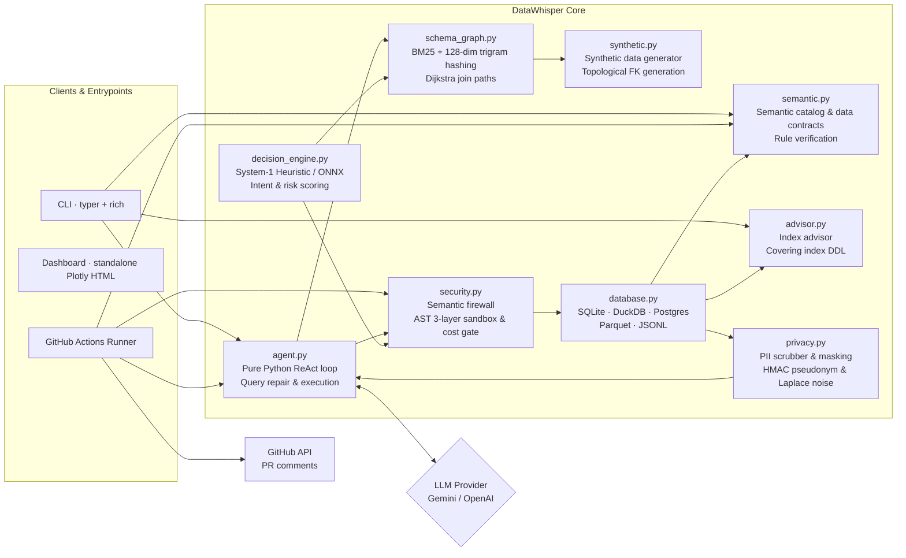

# DataWhisper v1.5.9

DataWhisper is a local data analysis tool and CI/CD pull request auditor for relational databases and columnar files.

It runs locally against SQLite, DuckDB, PostgreSQL, Parquet, and JSONL. It treats language models as untrusted: the model drafts SQL, while syntax validation, execution limits, data contracts, and data masking remain in deterministic code you can inspect.

[](https://github.com/Green-tero/datawhisper/actions/workflows/ci.yml)


**Configuration reference:** [docs/configuration.md](docs/configuration.md) · **Changelog:** [CHANGELOG.md](CHANGELOG.md) · **Contributing:** [CONTRIBUTING.md](CONTRIBUTING.md) · **Security:** [SECURITY.md](SECURITY.md)

---

<details>
<summary><b>🇮🇷 راهنمای جامع به زبان فارسی / Persian Documentation (برای مشاهده کلیک کنید)</b></summary>

<br/>

## دیتاویسپر چیست؟

دیتاویسپر یک ابزار محلی برای تحلیل داده‌های رابطه‌ای و ناظر خودکار تغییرات دیتابیس در Pull Request است.

این ابزار روی پایگاه‌های داده SQLite، DuckDB، PostgreSQL و فایل‌های Parquet و JSONL اجرا می‌شود. فرض اصلی در طراحی دیتاویسپر، **عدم اعتماد به خروجی مدل زبانی (Zero-Trust)** است: مدل فقط کدهای SQL پیشنهادی را می‌نویسد؛ در حالی که اعتبارسنجی نحو (AST)، ارزیابی هزینه در پلنر دیتابیس، بررسی قراردادهای داده و ماسک‌گذاری مقادیر حساس (PII) تماماً در کدهای قطعی پایتون انجام می‌شود.

### قابلیت‌های اصلی

1. **تحلیل داده به زبان طبیعی:** سؤال تحلیلی خود را مطرح کنید. دیتاویسپر با استفاده از BM25 و ویژگی‌های هشینگ کاراکتر-تری‌گرام ۱۲۸ بعدی، جداول و مسیرهای اتصال مرتبط را بدون نیاز به مدل‌های برداری سنگین فیلتر می‌کند. کوئری تولیدشده پیش از اجرا از فایروال معنایی، اعتبارسنجی AST و گیت بررسی پلن عبور می‌کند.
2. **بررسی تغییرات دیتابیس در CI/CD:** در هر Pull Request که شامل فایل‌های مایگریشن یا اسکیمای جدید باشد، دیتاویسپر مواردی مانند پس‌رفت پلن اجرایی (تبدیل Index Scan به Table Scan)، ریسک‌های قفل جدول (Table Lock)، حذف مخرب ستون‌ها و ورود فیلدهای حساس را کشف کرده و گزارش آن را در PR ثبت می‌کند.
3. **قراردادهای داده (Data Contracts):** با دستور `datawhisper contract` می‌توانید شرایط اعتبارسنجی ستون‌ها (`NOT NULL`، یکتایی مقادیر و حداقل تعداد سطرها) را در پایپ‌لاین‌های تست ارزیابی کنید.
4. **مشاور ایندکس‌گذاری (Index Advisor):** با اجرای `datawhisper advise` روی یک کوئری، ستون‌های فیلتر و کلیدهای اتصال بدون ایندکس شناسایی شده و دستور ساخت ایندکس بهینه متناسب با دیالکت دیتابیس پیشنهاد می‌شود.
5. **تولید داده‌های تست ساختگی (Synthetic Data):** با کمک `SyntheticDataGenerator`، داده‌های تستی متناسب با کلیدهای خارجی و وابستگی‌های ترتیبی جداول (با الگوریتم مرتب‌سازی توپولوژیک) تولید می‌شوند تا نیازی به استفاده از دیتای واقعی پروداکشن در محیط‌های تست نباشد.

دیتاویسپر هیچ وابستگی به فریم‌ورک‌های LangChain یا LlamaIndex ندارد. حلقه عامل یک حلقه ReAct مینیمال و مستقل در پایتون خالص است.

---

### پایگاه‌های داده و فرمت‌های پشتیبانی‌شده

| منبع | درایور / موتور | دسترسی و ویژگی‌های امنیتی |
| ---- | -------------- | ------------------------- |
| `.sqlite`, `.db` | `sqlite3` استاندارد | بازشده در حالت فقط‌خواندنی (`mode=ro` و `query_only=ON`) |
| `.duckdb` | درایور DuckDB | دسترسی فقط‌خواندنی (`read_only=True`) |
| `.parquet`, `.pq` | ویوی درون‌حافظه‌ای DuckDB | دسترسی فقط‌خواندنی؛ توابع فایل در لایه AST مسدود هستند |
| `.jsonl`, `.ndjson` | ویوی درون‌حافظه‌ای DuckDB | استخراج وکتورایز‌شده اسکیمای JSON |
| `.csv` | DuckDB (با فال‌بک SQLite) | تشخیص تایپ‌ها و بارگذاری درون‌حافظه‌ای |
| `postgres://...` | psycopg نسخه ۳ | تراکنش فقط‌خواندنی همراه با `statement_timeout` سمت سرور |

---

### راه‌اندازی سریع

نیازمند **پایتون ۳.۱۳، ۳.۱۴ یا ۳.۱۵**:

```bash
git clone https://github.com/Green-tero/datawhisper.git
cd datawhisper

# نصب پکیج با وابستگی‌های DuckDB و Arrow
pip install -e ".[duckdb,arrow]"

# یا نصب تمام بسته‌ها برای محیط توسعه
poetry install --with dev --extras "duckdb arrow postgres llm"
```

تنظیم کلید مدل‌ها (اختیاری برای تحلیل‌های متکی به مدل):
```bash
export GEMINI_API_KEY="your-gemini-key"
# یا
export OPENAI_API_KEY="your-openai-key"
```

---

### دموی ۶۰ ثانیه‌ای

```bash
# ایجاد دیتابیس تستی نمونه
python -c "
import sqlite3
c = sqlite3.connect('demo.sqlite')
c.executescript('''
CREATE TABLE customers (id INTEGER PRIMARY KEY, name TEXT, email TEXT);
CREATE TABLE orders (id INTEGER PRIMARY KEY, customer_id INTEGER, amount REAL, status TEXT);
INSERT INTO customers VALUES (1, 'Ada Lovelace', 'ada@example.com'), (2, 'Alan Turing', 'alan@example.com');
INSERT INTO orders VALUES (1, 1, 150.0, 'paid'), (2, 2, 75.0, 'pending');
''')
c.commit()
"

# ۱. مشاهده ساختار اسکیما و ستون‌ها
datawhisper inspect --source demo.sqlite

# ۲. دریافت پیشنهاد ایندکس برای کوئری
datawhisper advise "SELECT * FROM orders WHERE status = 'paid'" --source demo.sqlite

# ۳. اعتبارسنجی قرارداد داده
datawhisper contract --source demo.sqlite --table customers --not-null name --min-rows 2

# ۴. بررسی سندباکس و پلن اجرایی بدون اجرای SQL
datawhisper explain "SELECT * FROM customers c JOIN orders o ON c.id = o.customer_id" --source demo.sqlite

# ۵. پرسش به زبان طبیعی
datawhisper ask "which customers have paid orders?" --source demo.sqlite
```

*(توجه: در تمامی دستورات می‌توان از `--db` به عنوان نام مستعار `--source` استفاده کرد).*

---

### دستورات CLI

| دستور | شرح |
| ----- | --- |
| `datawhisper ask "<سؤال>" --source <مسیر> [--explain-only]` | اجرای تحلیل عاملی؛ سوئیچ `--explain-only` کانتکست هرس‌شده و کوئری را بدون ارسال به دیتابیس نمایش می‌دهد. |
| `datawhisper advise "<کوئری>" --source <مسیر>` | تحلیل شروط کوئری و پیشنهاد ایندکس‌های مناسب همراه با درصد تخمینی بهبود هزینه. |
| `datawhisper contract --source <مسیر> --table <جدول> [قوانین]` | ارزیابی زنده قرارداد داده روی جداول (`--not-null`، `--unique`، `--min-rows`) در پایپ‌لاین‌های CI. |
| `datawhisper inspect --source <مسیر> [--profile <جدول>.<ستون>]` | بازرسی کاتالوگ اسکیما، پروفایل مقادیر ستون یا بررسی نحوه هرس اسکیما. |
| `datawhisper explain "<کوئری>" --source <مسیر>` | اجرای آزمایشی در سندباکس AST و پلنر دیتابیس بدون دستکاری دیتا. |
| `datawhisper dashboard --source <مسیر> [-o report.html]` | تولید داشبورد بصری HTML مستقل با نمودارهای تحلیلی Plotly. |
| `datawhisper audit --base-sql a.sql --head-sql b.sql --dry-run` | ممیزی استاتیک مایگریشن‌ها و تغییرات اسکیما بدون ارسال به گیت‌هاب. |
| `datawhisper audit --repo o/r --pr N --base-ref main --head-ref SHA --ci-audit` | اجرای خودکار ممیزی در GitHub Actions و ثبت کامنت در Pull Request. |

---

### لایه‌های امنیتی و اجرایی

#### فایروال معنایی (Semantic Firewall)
پیش از پارس نحو، یک ارزیابی سریع زیر ۳۰ میکروثانیه انجام می‌شود. دستورات تخریبی (`DROP`، `TRUNCATE`، `DELETE`های بدون شرط) و الگوهای تزریق پرامپت بلافاصله متوقف می‌شوند.

#### سندباکس سه‌لایه AST
- **واژگانی (Lexical):** عدم پذیرش کاراکتر سمی‌کالن (`;`) و نشانه‌های کامنت (`--` و `/* */`) حتی داخل رشته‌ها، برای مسدود کردن ناسازگاری‌های پارسر دیتابیس.
- **ساختاری (Structural):** پذیرش فقط یک دستور با ریشه `SELECT`، `WITH` یا `EXPLAIN`.
- **معنایی (Semantic):** مسدودسازی توابع خواندن فایل (`read_csv`، `read_parquet_raw`)، توابع دسترسی به شل سیستم‌عامل و توابع ادمین Postgres (`pg_read_file`).

#### گیت هزینه پلن (Plan Cost Gate)
- **رد اتصالات دکارتی:** مسدودسازی کوئری‌هایی که اتصال جداول در آن‌ها فاقد شرط معتبر است (`CROSS JOIN` یا اتصالات بدون شرط).
- **سقف اسکن:** کنترل تعداد سطر اسکن‌شده و اعمال خودکار بند `LIMIT` برای کوئری‌های تحلیلی نامحدود.

#### پالایش و ماسک داده‌های حساس (PII Scrubbing)
پالایش درون موتور انجام شده و مقادیر خام هرگز خارج نمی‌شوند:
- `hash`: هش پایدار HMAC-SHA256 بر اساس `DW_PII_SALT`.
- `pseudonymize`: مستعارسازی سازگار جهت حفظ امکان `JOIN` روی داده‌های ماسک‌شده.
- `differential_privacy`: تزریق نویز لاپلاس روی خروجی‌های تجمیعی عددی (به صورت per-query و بدون حسابداری سراسری بودجه).
- `mask`: ماسک کاراکترها (مانند `a***@example.com`).
- `tokenize`: توکن‌های یکتای هر اجرا (مانند `<EMAIL:1>`).
- `redact`: متن ثابت جایگزین (مانند `[REDACTED:EMAIL]`).

---

### محدودیت‌ها و اهداف خارج از دامنه (Non-Goals)

- **فقط‌خواندنی:** دیتاویسپر صرفاً برای کوئری‌های تحلیلی و ممیزی اسکیما طراحی شده است. دستورات تغییر دیتا (`INSERT`, `UPDATE`, `DELETE`, `DROP`, `ALTER`) مسدود می‌شوند. این ابزار کنسول مدیریت دیتابیس نیست.
- **عدم جایگزینی پایپ‌لاین‌های ETL:** دیتاویسپر وظیفه زمان‌بندی یا تبدیل انبوه داده‌ها را بر عهده ندارد؛ برای این منظور از ابزارهایی مانند dbt یا Airflow استفاده کنید.
- **هشینگ ویژگی در برابر امبدینگ عصبی:** فیلتر اسکیما از ترکیب BM25 و ترای‌گرام کاراکتری ۱۲۸ بعدی بهره می‌برد؛ این فرآیند سبک و آفلاین بوده و نیازی به دیتابیس‌های وکتوری یا مدل‌های سنگین ندارد.
- **محدوده حریم خصوصی دیفرانسیل:** قابلیت Differential Privacy روی نتایج عددی هر کوئری نویز لاپلاس اضافه می‌کند و حسابداری سراسری تجمعی بین کوئری‌های متوالی را شامل نمی‌شود.
- **امنیت چندلایه:** ایزولاسیون فایل‌های Parquet در DuckDB متکی به سندباکس AST است. برای PostgreSQL در محیط عملیاتی، همواره باید از یوزرهای فقط‌خواندنی دیتابیس با `statement_timeout` فعال استفاده شود.

---

### بنچمارک‌ها

اندازه‌گیری‌شده روی سخت‌افزار استاندارد (ویندوز، پایتون ۳.۱۵ و دیتابیس در حافظه):

| عملیات | ماژول | میانه زمان اجرا |
| ------ | ----- | --------------- |
| **تصمیم‌گیری System-1** | ارزیابی نیت و ریسک | **~۲۳ میکروثانیه** |
| **فایروال معنایی** | بررسی ریجکس و توکن‌ها | **~۲۰ میکروثانیه** |
| **اعتبارسنجی AST** | تحلیل ساختاری با sqlglot | **~۰.۷۷ میلی‌ثانیه** |
| **هرس اسکیما** | ترکیب BM25 و ترای‌گرام ۱۲۸ بعدی (۵۰ جدول) | **~۱.۲۹ میلی‌ثانیه** |
| **مشاور ایندکس** | تحلیل شروط و تولید DDL | **~۰.۳۵ میلی‌ثانیه** |
| **پالایش PII** | ۱۰٬۰۰۰ سلول در ۴ ستون با مسیرهای سریع | **~۶۱ میلی‌ثانیه** |
| **تولید داده ساختگی** | ۱٬۰۰۰ سطر با حفظ کلید خارجی | **~۲.۹۴ میلی‌ثانیه** |
| **سوئیت کامل تست‌ها** | ۲۰۶ تست واحد و یکپارچگی | **~۶.۲ ثانیه** |

اجرای بنچمارک‌ها:
```bash
python benchmarks/run_benchmarks.py
```

</details>

---

<details open>
<summary><b>🇬🇧 English Documentation (Click to collapse)</b></summary>

<br/>

## What it does

1. **Natural-language data analysis under zero-trust assumptions:** Ask analytical questions about your database. DataWhisper classifies intent and filters large schemas down to candidate tables using BM25 and 128-dimensional character-trigram feature hashing. It drafts SQL with a local or remote model, verifies the AST, checks the query execution plan with a cost gate, repairs driver errors, and masks sensitive values before returning data.
2. **CI/CD migration and schema review:** On pull requests changing SQL migrations or schemas, DataWhisper diffs DDL, flags newly added sensitive columns, catches execution plan regressions (such as an index scan turning into a table scan), checks for migration lock risks and missing foreign-key indexes, and posts sticky summary reports to the pull request.
3. **Runtime data contracts:** Verify business expectations (`NOT NULL`, allowed values, minimum row counts) on tables in pipelines or test suites with `datawhisper contract`.
4. **Index recommendations:** Inspect query predicates and join keys across SQLite, PostgreSQL, and DuckDB with `datawhisper advise` to identify unindexed filter columns and generate covering index statements.
5. **Synthetic test data generation:** Generate referentially integral test datasets directly from schema catalog snapshots with `SyntheticDataGenerator`, avoiding the need to copy production data into test environments.

There is no LangChain or LlamaIndex dependency. The agent loop is a small, deterministic ReAct loop in pure Python. Every statement passes through the semantic firewall, AST parser, and query planner cost gate.

---

## Architecture



---

## Supported engines

| Source | Backend | Security & Access Profile |
| ------ | ------- | ------------------------- |
| `.sqlite`, `.db` | `sqlite3` (stdlib) | Opened `mode=ro` with `query_only=ON` |
| `.duckdb` | DuckDB driver | Opened `read_only=True` |
| `.parquet`, `.pq` | DuckDB in-memory view | Read-only view; file access functions blocked at AST layer |
| `.jsonl`, `.ndjson` | DuckDB in-memory view | Vectorized JSON schema extraction |
| `.csv` | DuckDB (SQLite fallback) | Schema inference and type ingestion |
| `postgres://...` | psycopg (v3) | Read-only transaction with server-side `statement_timeout` |

---

## Quickstart

Requires **Python 3.13, 3.14, or 3.15**:

```bash
git clone https://github.com/Green-tero/datawhisper.git
cd datawhisper

# Install core package with DuckDB and Arrow support
pip install -e ".[duckdb,arrow]"

# Or install all extras for development
poetry install --with dev --extras "duckdb arrow postgres llm"
```

To configure model providers (optional for local heuristic operations):
```bash
export GEMINI_API_KEY="your-gemini-key"
# or
export OPENAI_API_KEY="your-openai-key"
```

---

## 60-second demo

```bash
# Create a sample database
python -c "
import sqlite3
c = sqlite3.connect('demo.sqlite')
c.executescript('''
CREATE TABLE customers (id INTEGER PRIMARY KEY, name TEXT, email TEXT);
CREATE TABLE orders (id INTEGER PRIMARY KEY, customer_id INTEGER, amount REAL, status TEXT);
INSERT INTO customers VALUES (1, 'Ada Lovelace', 'ada@example.com'), (2, 'Alan Turing', 'alan@example.com');
INSERT INTO orders VALUES (1, 1, 150.0, 'paid'), (2, 2, 75.0, 'pending');
''')
c.commit()
"

# 1. Inspect schema tables and columns
datawhisper inspect --source demo.sqlite

# 2. Get covering index recommendations for a query
datawhisper advise "SELECT * FROM orders WHERE status = 'paid'" --source demo.sqlite

# 3. Verify data contracts
datawhisper contract --source demo.sqlite --table customers --not-null name --min-rows 2

# 4. Check sandbox validation and query execution plan without running SQL
datawhisper explain "SELECT * FROM customers c JOIN orders o ON c.id = o.customer_id" --source demo.sqlite

# 5. Ask a question with natural language
datawhisper ask "which customers have paid orders?" --source demo.sqlite
```

*(Note: `--db` is accepted as an alias for `--source` across all commands).*

---

## CLI commands

| Command | Description |
| ------- | ----------- |
| `datawhisper ask "<question>" --source <path> [--explain-only]` | Run the agent against the database. `--explain-only` prints pruned schema context and candidate SQL without executing. |
| `datawhisper advise "<sql>" --source <path>` | Analyze query predicates and propose covering index statements with estimated cost reduction. |
| `datawhisper contract --source <path> --table <name> [rules]` | Validate table constraints (`--not-null`, `--unique`, `--min-rows`) in CI or pipeline jobs. |
| `datawhisper inspect --source <path> [--profile <table>.<col>]` | View schema catalog, profile column distributions, or test schema retrieval. |
| `datawhisper explain "<sql>" --source <path>` | Run statement through AST validation and the planner cost gate without executing. |
| `datawhisper dashboard --source <path> [-o report.html]` | Generate a standalone Plotly HTML report with distribution and correlation charts. |
| `datawhisper audit --base-sql a.sql --head-sql b.sql --dry-run` | Run offline migration audit for schema drift, lock risks, and unindexed foreign keys. |
| `datawhisper audit --repo o/r --pr N --base-ref main --head-ref SHA --ci-audit` | Run full automated review in GitHub Actions and comment on the pull request. |

---

## Security & execution guardrails

### Semantic firewall
Before parsing ASTs, a fast System-1 classifier scores statement risk in under 30 microseconds. Explicit destructive statements (`DROP`, `TRUNCATE`, unconstrained `DELETE`) and prompt-injection patterns are rejected before hitting the database or LLM.

### AST sandbox
- **Lexical:** Rejects semicolons (`;`) and comment tokens (`--`, `/* */`), even within string literals, to close parser-differential bypass vectors.
- **Structural:** Enforces a single statement root of type `SELECT`, `WITH`, or `EXPLAIN`.
- **Semantic:** Blocks arbitrary file reading (`read_csv`, `read_parquet_raw`), subprocess execution, extension loading, and Postgres administrative functions (`pg_read_file`).

### Query plan cost gate
- **Cartesian joins:** Rejects queries with disconnected join graphs (`CROSS JOIN` or multiple `FROM` tables lacking join conditions).
- **Scan limits:** Enforces row scan ceilings from execution plans and automatically injects root `LIMIT` clauses on unbounded analytical queries.

### Privacy & PII scrubbing
Scrubbing runs inside the engine before data leaves memory:
- `hash`: HMAC-SHA256 tokenization using `DW_PII_SALT`.
- `pseudonymize`: Consistent HMAC pseudonymization preserving foreign key equality across `JOIN` and `GROUP BY`.
- `differential_privacy`: Calibrated Laplace noise on aggregated numeric outputs (experimental per-query noise; no cross-query budget ledger).
- `mask`: Character masking (e.g. `a***@example.com`).
- `tokenize`: Ephemeral run tokens (e.g. `<EMAIL:1>`).
- `redact`: Static placeholder (e.g. `[REDACTED:EMAIL]`).

---

## Limitations & non-goals

- **Read-only analytics:** DataWhisper is designed for read-only querying and pull request schema auditing. Mutation operations (`INSERT`, `UPDATE`, `DELETE`, `DROP`, `ALTER`) are rejected in query mode. It is not a database administration console.
- **Not an ETL orchestrator:** DataWhisper does not transform or schedule data pipelines. Use dbt or Apache Airflow for data transformation workflows.
- **Feature hashing vs. deep embeddings:** Schema graph ranking uses BM25 alongside 128-dimensional character-trigram feature hashing. This provides fast, offline, and lightweight retrieval without requiring external vector databases or multi-gigabyte neural models.
- **Differential privacy scope:** The differential privacy mode injects Laplace noise on numeric metric values on a per-query basis. It does not implement global privacy budget tracking across recurring queries.
- **Defense in depth:** DuckDB file views rely on AST sandbox blocking for isolation. For PostgreSQL, production deployments should always use dedicated read-only database roles with server-side `statement_timeout` configured.

---

## Benchmarks

Measured on standard hardware (Windows, Python 3.15, in-memory engines):

| Operation | Component | Median Latency |
| --------- | --------- | -------------- |
| **System-1 Decision** | Intent and risk scoring | **~23 µs** |
| **Semantic Firewall** | Substring and regex rules | **~20 µs** |
| **AST Validation** | sqlglot structural parsing | **~0.77 ms** |
| **Schema Pruning** | BM25 + 128-dim trigram hashing (50 tables) | **~1.29 ms** |
| **Index Recommendation** | AST predicate extraction and DDL | **~0.35 ms** |
| **PII Scrubbing** | 10,000 cells across 4 columns (with fast-paths) | **~61 ms** |
| **Synthetic Generation** | 1,000 rows with referential integrity | **~2.94 ms** |
| **Full Test Suite** | 206 unit and integration tests | **~6.2 s** |

To reproduce these benchmarks locally:
```bash
python benchmarks/run_benchmarks.py
```

---

## Development

```bash
# Install development dependencies
poetry install --with dev --extras "duckdb arrow postgres llm"
pre-commit install

# Run quality checks
poetry run pytest -v          # 206 tests passing
poetry run ruff check .       # linting
poetry run black --check .    # code style formatting
poetry run mypy datawhisper   # strict static type check
```

</details>

---

## Documentation

- [Full Configuration Guide](docs/configuration.md) — Reference table of all environment variables (`DW_*`).
- [Persian Documentation / راهنمای فارسی](docs/README.fa.md) — Standalone documentation in Persian.
- [Security Policy](SECURITY.md) — Security model and vulnerability reporting.
- [Contributing Guide](CONTRIBUTING.md) — Contribution guidelines and pull request workflow.

---

## License

Apache-2.0. See [LICENSE](LICENSE).
