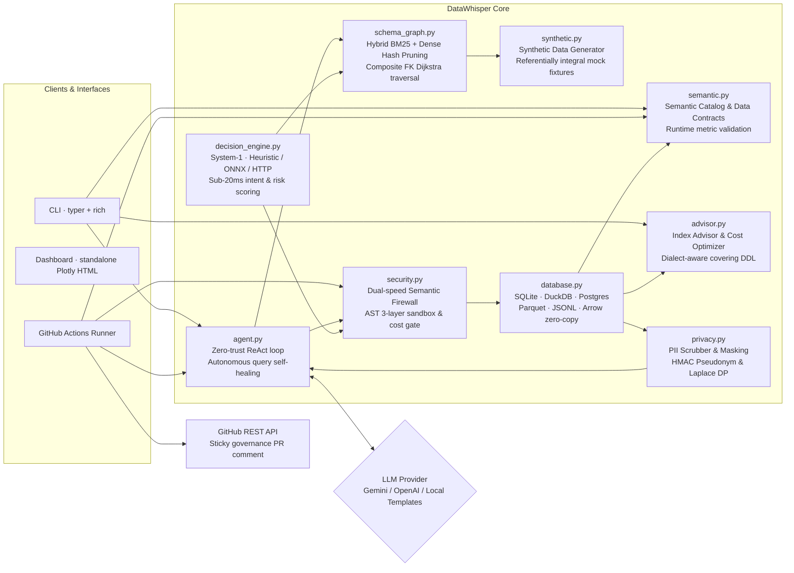
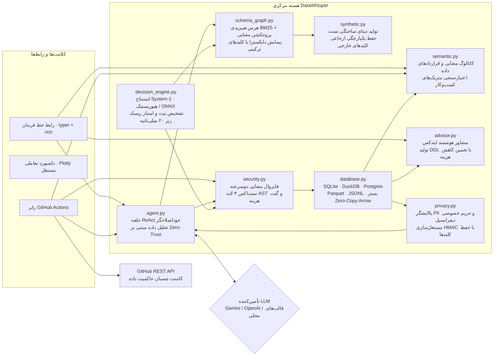

# DataWhisper v1.5

DataWhisper answers questions about your data and reviews database changes in pull requests.

It runs locally, works across SQLite, DuckDB, PostgreSQL, Parquet and JSONL, and treats the language model as untrusted: the model proposes SQL, while validation, cost limits, data contracts, and data masking stay in code you can inspect.

**Current release: 1.5.5.** See [CHANGELOG.md](CHANGELOG.md).

[](https://github.com/Green-tero/datawhisper/actions/workflows/ci.yml)


**Language / زبان:** open a section below. English is open by default.

<details open>
<summary><b>🇬🇧 &nbsp;English</b></summary>

<br>

**Contents:** [What it does](#what-it-does) · [What's new in 1.5](#whats-new-in-15) · [Architecture](#architecture) · [Security & Governance](#security--governance) · [Supported engines](#supported-engines) · [Quickstart](#quickstart) · [60-second demo](#try-it-in-60-seconds) · [Commands](#commands) · [GitHub Action](#using-it-as-a-github-action) · [Configuration](#configuration) · [Benchmarks](#benchmarks) · [Development](#development) · [License](#license)

## What it does

**1. A local, zero-trust data analysis agent.** Ask a question about your database in natural language. DataWhisper classifies intent and prunes massive schemas down to the relevant tables and join paths using hybrid sparse-dense ranking (no LLM needed for schema selection). It synthesizes SQL locally or generates it via an LLM, validates the AST, evaluates execution cost via planner plans, intercepts destructive or prompt-injection patterns with a sub-millisecond firewall, repairs execution errors autonomously, and scrubs sensitive PII values before any data leaves the engine.

**2. A CI/CD database governance reviewer.** On pull requests that touch SQL, migration files, or analytical datasets, DataWhisper diffs DDL schemas, audits for newly introduced PII columns, detects query plan regressions (e.g. an index scan turning into a sequential scan), performs static migration audits (table-lock hazards, destructive column drops, missing foreign-key indexes), and comments directly on the PR with interactive Plotly artifacts.

**3. Runtime Data Contracts & Semantic Layer.** Define business metrics, dimensions, and table contracts declaratively. Enforce constraints (`NOT NULL`, uniqueness, minimum row counts) on tables in CI pipelines or runtime environments with `datawhisper contract` to catch corrupted data before models or dashboards consume it.

**4. Automated Index Advisor.** Analyze query predicates and join keys across SQLite, PostgreSQL, and DuckDB with `datawhisper advise`. The advisor identifies unindexed filter columns and foreign keys, suggests dialect-specific covering indexes, and estimates query cost reduction percentages.

**5. Synthetic Mock Data Generation.** Generate referentially integral, structurally coherent mock datasets directly from catalog snapshots with `SyntheticDataGenerator`, enabling reliable and air-gapped CI tests without exposing production data.

No LangChain, no LlamaIndex. The agent is a small, deterministic ReAct loop in pure Python. Every statement is checked by the semantic firewall, parsed as an AST, passed through an EXPLAIN-based cost gate, and sanitized by the privacy scrubber.

## What's new in 1.5

| Area | Prior Releases (1.3–1.4) | 1.5 Series (Current: 1.5.5) |
| --- | --- | --- |
| **Semantic Layer & Contracts** | Ad-hoc queries and prompt context | Declarative `SemanticCatalog`, `MetricDefinition`, `DimensionDefinition`, and `TableContract` with CLI verification (`datawhisper contract`) |
| **Differential Privacy** | Hash, mask, tokenize, redact modes | Added $\epsilon$-$\delta$ Differential Privacy (`mode="differential_privacy"`) with calibrated Laplace noise injection and non-negative count bounding |
| **Index Recommendation** | Manual query plan inspection | Automated AST-driven `IndexAdvisor` proposing single and composite covering indexes with estimated cost reduction |
| **Schema Pruning** | BM25 + coarse domain tokenization | Hybrid sparse-dense retrieval: BM25 + 128-dimensional dense semantic hash projection (`DW_GRAPH_HYBRID_DENSE=true`) |
| **Synthetic Test Data** | Static hand-crafted test fixtures | `SyntheticDataGenerator` creating referentially integral mock tables directly from catalog snapshots |
| **System-1 Inference** | Heuristic rules or external endpoints | Embedded ONNX driver (`LayaOnnxDriver`) with deterministic CRC32 token projection and shared canonical safety policies |
| **Pseudonymization** | Single-run tokenization or static hashes | Persistent HMAC-SHA256 pseudonymization (`mode="pseudonymize"`) preserving referential integrity across `JOIN` and `GROUP BY` |
| **Schema Graph Traversal** | Single-column FKs only | Composite foreign key joins, weighted Dijkstra pathfinding, and cached traversal paths for frequent table pairs |

## Architecture



### The execution pipeline

1. **System-1 intent classification and schema pruning:** A local decision engine classifies the question (aggregation, lookup, trend, schema inspection, or quality check). The schema graph prunes tables coarse-to-fine: leading-token domain grouping, hybrid BM25 + dense semantic hash projection, and Dijkstra shortest join paths. Only the minimal necessary subgraph enters the prompt.
2. **Dialect query generation:** The model drafts SQL in the target engine's dialect (or synthesizes from local templates with `DW_LLM_PROVIDER=local`). `transpile_sql` validates dialect syntax before transpilation.
3. **Guardrails and execution:** 
   - **Semantic Firewall:** Scores input for destructive DDL, prompt-injections, or cross-tenant leaks in sub-millisecond time.
   - **AST Sandbox:** Inspects parsed abstract syntax trees; permits only single read statements, rejecting mutating statements, dangerous file readers, and comment-based escapes.
   - **Cost Gatekeeper:** Evaluates `EXPLAIN` query plans, detects Cartesian products, and bounds unbounded scans with safe `LIMIT` clauses.
4. **Synthesis and Privacy Scrubbing:** Results pass through the in-engine privacy scrubber before reaching LLM contexts, terminals, or PR comments. All execution telemetry (System-1, System-2, and execution latencies) is recorded.

## Security & Governance

### System-1 semantic firewall (`core/decision_engine.py` + `core/security.py`)

Before AST parsing begins, input is scored by the fast semantic risk engine. Destructive queries (`DROP`, `TRUNCATE`, unbounded `DELETE`), prompt injection payloads, and cross-tenant leakage patterns are rejected immediately. Scores exceeding `DW_RISK_THRESHOLD` (default `0.7`) abort execution with a `SecurityViolation`.

### Three-layer AST sandbox (`core/security.py`)

| Layer | Enforcement |
| --- | --- |
| **Lexical** | Blocks semicolons (`;`) and comment tokens (`--`, `/* */`), even inside string literals, to neutralize parser-differential injection attacks. |
| **Structural** | Validates that the query contains exactly one root statement belonging to an allowed type (`SELECT`, set operations, scalar subqueries, CTEs, or `EXPLAIN`). |
| **Semantic** | Forbids mutating operations in any sub-tree (including within `WITH` clauses), filesystem functions (`read_csv`, `read_parquet_raw`), extension loaders (`INSTALL`, `LOAD`), system commands (`pg_read_file`, `dblink`, `getenv`), and cross-database catalog escapes (`catalog.schema.table`). |

### Cost gatekeeper

- **Cartesian products are rejected:** Evaluates both AST structure (tables joined without joining predicates) and plan estimates for implicit cross joins.
- **Unbounded scans are paginated:** If an estimated scan exceeds `DW_MAX_SCAN_ROWS`, an automatic `LIMIT` is injected and re-verified.
- **Fail-closed options:** If the planner fails or lacks cost estimates, `DW_PLAN_FAILURE_POLICY` dictates whether to continue with runtime timeouts (`allow_with_budget`) or strictly reject (`reject`).

### Privacy engine & PII scrubbing (`core/privacy.py`)

Sensitive columns and values are detected using a combination of column name heuristics and regex value detectors (email, Luhn-verified credit cards, SSNs, phone numbers, IP addresses, JWT tokens, AWS/OpenAI/GitHub API keys).

| Mode | Behavior & Output Example |
| --- | --- |
| `hash` *(default)* | `email_9f2c7a...` — Deterministic HMAC-SHA256 with `DW_PII_SALT`; consistent across runs. |
| `pseudonymize` | `ps_a1b2c3...` — Persistent session-scoped HMAC pseudonymization; preserves referential integrity across `JOIN` and `GROUP BY`. |
| `differential_privacy` | Adds calibrated Laplace noise ($\mu + \text{Lap}(1/\epsilon)$) to analytical numeric metrics with non-negative bounds protection. |
| `mask` | Masks values partially (e.g. `a***@example.com`, `**** **** **** 1111`). |
| `tokenize` | Ephemeral tokens (`<EMAIL:1>`) consistent only within a single session run. |
| `redact` | Explicit redaction markers (`[REDACTED:EMAIL]`). |

## Supported engines

| Source | Driver | Dialect | Connection & Security Profile |
| --- | --- | --- | --- |
| `.sqlite`, `.db`, `.sqlite3` | stdlib `sqlite3` | sqlite | Opened `mode=ro` with `query_only=ON` |
| `.duckdb` | `duckdb` | duckdb | Opened `read_only=True` |
| `.parquet`, `.pq`, directories | DuckDB view | duckdb | Zero-copy Apache Arrow integration |
| `.jsonl`, `.ndjson` | DuckDB `read_json_auto` | duckdb | Vectorized nested schema extraction |
| `.csv` | DuckDB (or SQLite fallback) | duckdb/sqlite | Strongly-typed automatic ingestion |
| `postgres://...` | `psycopg` (v3) | postgres | Read-only transaction with server-side `statement_timeout` |

## Quickstart

Requires **Python 3.11+**. Install directly from this repository:

```bash
git clone https://github.com/Green-tero/datawhisper.git
cd datawhisper

# User installation
pip install -e ".[duckdb,arrow]"     # add ,postgres and ,llm as needed

# Developer installation with dev dependencies
poetry install --with dev --extras "duckdb arrow postgres llm"
```

Set your model provider key (if using external LLMs):

```bash
export GEMINI_API_KEY="your-api-key"   # or OPENAI_API_KEY="your-api-key"
```

## Try it in 60 seconds

```bash
python - <<'PY'
import sqlite3
db = sqlite3.connect("demo.sqlite")
db.executescript("""
CREATE TABLE customers (id INTEGER PRIMARY KEY, name TEXT, email TEXT, country TEXT);
CREATE TABLE orders (id INTEGER PRIMARY KEY, customer_id INTEGER REFERENCES customers(id),
                     amount REAL, status TEXT, placed_at TEXT);
INSERT INTO customers VALUES (1,'Ada','ada@example.com','UK'),(2,'Alan','alan@example.com','UK'),
                             (3,'Maryam','m@example.org','IR'),(4,'Grace',NULL,'US');
INSERT INTO orders VALUES (1,1,120.5,'paid','2024-05-01'),(2,1,35.0,'paid','2024-05-02'),
                          (3,2,89.9,'pending','2024-05-03'),(4,2,NULL,'refunded','2024-05-04'),
                          (5,3,250.0,'paid','2024-05-05'),(6,4,64.0,'pending','2024-05-06');
""")
db.commit()
PY

# 1. Preview how the hybrid schema pruner isolates relevant tables
datawhisper inspect --source demo.sqlite --graph "revenue per customer country"

# 2. Inspect query cost and AST validation without executing
datawhisper explain "SELECT * FROM customers c JOIN orders o ON c.id = o.customer_id" --source demo.sqlite

# 3. Get automated index recommendations for slow analytical queries
datawhisper advise "SELECT * FROM orders WHERE status = 'paid' ORDER BY placed_at DESC" --source demo.sqlite

# 4. Enforce runtime data contracts in CI/CD pipelines
datawhisper contract --source demo.sqlite --table orders --not-null amount --min-rows 5

# 5. Generate interactive dark-mode HTML dashboard
datawhisper dashboard --source demo.sqlite --sql "SELECT * FROM orders" -o report.html

# 6. Run autonomous natural language analysis (with API key or local templates)
datawhisper ask "which customer spent the most on paid orders?" --source demo.sqlite
```

## Commands

| Command | Description |
| --- | --- |
| `datawhisper ask "<q>" --source <src> [--explain-only]` | Run natural language analysis. `--explain-only` outputs pruned context and planned queries without calling LLM endpoints. |
| `datawhisper advise "<sql>" [--source <src>]` | Analyze query predicates and propose dialect-specific covering indexes with estimated cost reduction percentages. |
| `datawhisper contract --source <src> --table <tbl> [rules]` | Enforce declarative table contracts (`--not-null`, `--unique`, `--min-rows`) against live databases in CI pipelines. |
| `datawhisper inspect --source <src> [--profile t.c] [--graph "<q>"]` | Inspect table schemas, profile sensitive column distributions, or preview hybrid schema pruning subgraphs. |
| `datawhisper explain "<sql>" --source <src>` | Validate query through AST sandbox and normalized plan cost evaluation. |
| `datawhisper dashboard --source <src> [-o out.html] [--sql ...]` | Build standalone HTML dashboard with Plotly charts, plan trees, and data profiling. |
| `datawhisper audit --base-sql a.sql --head-sql b.sql --dry-run` | Offline migration and schema audit: detect schema drift, new PII exposures, and table-lock hazards. |
| `datawhisper audit --repo o/r --pr N --base-ref main --head-ref SHA --ci-audit` | Headless PR governance runner; posts and updates a sticky summary comment on pull requests. |

**CLI Exit Codes:** `0` Success, `1` Policy/Contract violation (or regression flagged with `--fail-on-regression`), `2` Configuration/Security error.

## Using it as a GitHub Action

Include [`.github/workflows/datawhisper-audit.yml`](.github/workflows/datawhisper-audit.yml) in your repository. It automatically audits pull requests touching SQL migrations, schema files, or database seeds:

```yaml
name: DataWhisper Governance Audit
on:
  pull_request:
    paths:
      - 'migrations/**'
      - 'db/**'
      - '**.sql'
      - '**.sqlite'
      - '**.duckdb'
      - '**.parquet'

jobs:
  audit:
    runs-on: ubuntu-latest
    steps:
      - uses: actions/checkout@v4
        with:
          fetch-depth: 0
      - uses: actions/setup-python@v5
        with:
          python-version: '3.12'
      - run: pip install -e ".[all]"
      - name: Run DataWhisper PR Audit
        env:
          GITHUB_TOKEN: ${{ secrets.GITHUB_TOKEN }}
          DW_PII_SALT: ${{ secrets.DW_PII_SALT }}
        run: |
          datawhisper audit \
            --repo ${{ github.repository }} \
            --pr ${{ github.event.pull_request.number }} \
            --base-ref ${{ github.base_ref }} \
            --head-ref ${{ github.head_ref }} \
            --ci-audit
```

The bot posts and updates a single sticky comment (`<!-- datawhisper:audit -->`) reporting:
- **Schema Drift:** Added, removed, or modified columns and type changes.
- **PII Exposure:** Columns newly classified as sensitive (emails, cards, keys).
- **Plan Regressions:** Index lookups regressed to sequential scans or Cartesian joins.
- **Migration Hazards:** Non-concurrent indexes, lock risks, and destructive drops.

## Configuration

| Environment Variable | Default | Purpose |
| --- | --- | --- |
| `GEMINI_API_KEY` / `OPENAI_API_KEY` | *empty* | Provider API credentials; not required for local template mode. |
| `DW_LLM_PROVIDER` | `none` | LLM provider: `gemini`, `openai`, `local` (offline deterministic synthesis), or `none`. |
| `DW_LLM_MODEL` | *auto* | Model identifier (or template profile for `local` mode). |
| `DW_DECISION_PROVIDER` | `auto` | System-1 engine: `auto`, `heuristic`, `onnx`, or `http`. Falls back safely to heuristic offline. |
| `DW_DECISION_MODEL_PATH` | *empty* | File path to local ONNX decision classification model. |
| `DW_LAYA_ENDPOINT` | *empty* | Base URL for remote HTTP System-1 inference endpoint. |
| `DW_RISK_THRESHOLD` | `0.7` | Semantic firewall threshold; queries scoring higher are rejected. |
| `DW_FIREWALL_ENABLED` | `true` | Toggle for fast semantic pre-execution risk check. |
| `DW_QUERY_TIMEOUT` | `10` | Hard query execution timeout in seconds. |
| `DW_MAX_ROWS` | `1000` | Maximum row cap returned per query result. |
| `DW_MAX_REPAIRS` | `3` | Autonomous self-healing retry budget for agent query errors. |
| `DW_COST_ENABLED` | `true` | Toggle for EXPLAIN-based cost gatekeeper. |
| `DW_MAX_SCAN_ROWS` | `5000000` | Estimated scan threshold before forcing automatic `LIMIT` pagination. |
| `DW_AUTO_LIMIT` | `500` | Default `LIMIT` clause injected for unpaginated large scans. |
| `DW_REJECT_CARTESIAN` | `true` | Strictly block Cartesian product queries. |
| `DW_PLAN_FAILURE_POLICY` | `allow_with_budget` | Behavior when planner fails: `allow_with_budget` (enforce row/time limits) or `reject`. |
| `DW_PII_ENABLED` | `true` | Enable in-engine PII redaction and scrubbing. |
| `DW_PII_MODE` | `hash` | Scrubbing mode: `hash`, `pseudonymize`, `differential_privacy`, `mask`, `tokenize`, `redact`. |
| `DW_PII_SALT` | *local default* | Secret HMAC salt for reproducible cross-run hashes in CI. |
| `DW_PII_HMAC_SALT` | *empty* | Session salt for persistent pseudonymization across sub-processes. |
| `DW_PII_DP_EPSILON` | `1.0` | Epsilon ($\epsilon$) privacy budget for Differential Privacy Laplace noise. |
| `DW_PII_ALLOW_COLUMNS` | *empty* | Comma-separated list of columns explicitly exempt from scrubbing. |
| `DW_GRAPH_MAX_TABLES` | `6` | Maximum tables selected during schema pruning. |
| `DW_GRAPH_MAX_COLUMNS` | `12` | Column cap per table included in prompt schema context. |
| `DW_GRAPH_MAX_TOKENS` | `1500` | Hard token budget allocated to pruned schema representation. |
| `DW_GRAPH_HYBRID_DENSE` | `true` | Enable hybrid BM25 + dense semantic hash projection. |
| `DW_GRAPH_HYBRID_WEIGHT` | `0.35` | Weight multiplier for dense semantic similarity in schema retrieval. |
| `DW_DOMAIN_PRUNING` | `true` | Enable coarse-to-fine domain token partitioning before graph traversal. |
| `DW_MAX_DOMAINS` | `3` | Maximum domain clusters retained in coarse pruning. |

## Benchmarks

Measured on standard development hardware (Windows, Python 3.15, in-memory engines):

| Operation | Implementation Path | Median Latency |
| --- | --- | --- |
| **System-1 Decision** | Heuristic / ONNX intent & risk evaluation | **0.02 – 0.04 ms** |
| **Semantic Firewall** | Fast regex & semantic token check | **0.02 ms** |
| **sqlglot AST Validation** | Multi-table join, subquery & CTE parsing | **0.22 ms** |
| **Hybrid Schema Pruning** | BM25 + Dense Hash Projection (60-table graph) | **1.12 ms** |
| **Index Recommendation** | AST predicate extraction & dialect index generation | **0.35 ms** |
| **PII Scrubbing** | 10,000 cells across 4 sensitive columns | **~0.38 s** |
| **Full Quality Test Suite** | 177 unit & integration tests across 9 test suites | **~2.6 s** |

## Development

```bash
# Set up development environment
poetry install --with dev --extras "duckdb arrow postgres llm"
pre-commit install

# Run complete quality gates
poetry run pytest -v          # 177 tests passing
poetry run ruff check .       # linting & style enforcement
poetry run black --check .    # code formatting
poetry run mypy datawhisper   # strict static type analysis
```

The test suite covers:
- Zero-trust AST security: 23 injection vectors, subqueries, recursive CTEs, and parser-differential bypass attempts.
- Cost gate invariants: Cartesian join detection, pagination injection, and plan failure fallbacks.
- Privacy & PII protection: Luhn validation, differential privacy Laplace clamping, and referential integrity under HMAC pseudonymization.
- Semantic layer & contracts: Table contract rules (`NOT NULL`, `UNIQUE`, row count bounds), and business metric resolution.
- Performance & pruning: 60-table graph retrieval, Dijkstra path caching, composite foreign keys, and synthetic data generation.

## License

Apache-2.0. See [LICENSE](LICENSE).

</details>

<details>
<summary><b>🇮🇷 &nbsp;فارسی</b></summary>

<br>

<div dir="rtl">

**فهرست:** [این پروژه چه کار می‌کند](#این-پروژه-چه-کار-می-کند) · [تازه‌های نسخه ۱.۵](#تازه-های-نسخه-۱۵) · [معماری](#معماری) · [امنیت و حاکمیت](#امنیت-و-حاکمیت) · [موتورهای پشتیبانی‌شده](#موتورهای-پشتیبانی-شده) · [راه‌اندازی سریع](#راه-اندازی-سریع) · [دموی ۶۰ ثانیه‌ای](#دموی-۶۰-ثانیه-ای) · [دستورات خط فرمان](#دستورات-خط-فرمان) · [اکشن گیت‌هاب](#استفاده-به-عنوان-github-action) · [تنظیمات](#تنظیمات) · [بنچمارک‌ها](#بنچمارک-ها) · [توسعه و تست](#توسعه-و-تست) · [مجوز](#مجوز)

## این پروژه چه کار می‌کند

**۱. عامل تحلیل داده با رویکرد عدم اعتماد مطلق (Zero-Trust).** سؤال تحلیلی خود را به زبان طبیعی بپرسید. دیتاویسپر با موتور تصمیم‌گیری محلی و بدون نیاز به ارسال کل اسکیما به مدل‌های ابری، جداول مرتبط و مسیرهای JOIN بهینه را با الگوریتم هیبریدی هرس می‌کند. سپس کوئری SQL را به صورت لوکال یا با مدل زبان می‌سازد، پیش از اجرا آن را از فایروال معنایی میکروثانیه‌ای، جعبه‌امن AST و دروازه تخمین هزینه عبور می‌دهد، خطاهای احتمالی را خودکار اصلاح می‌کند و داده‌های حساس (PII) را پیش از خروج از موتور پاک‌سازی می‌نماید.

**۲. ناظر خودکار Pull Request در پایپ‌لاین CI/CD.** در هر PR که کدهای SQL، مایگریشن‌ها یا فایل‌های داده تغییر کنند، دیتاویسپر مغایرت اسکیما در سطح ستون‌ها، ورود ستون‌های جدید حاوی داده‌های حساس، پس‌رفت پلن‌های اجرایی (تبدیل جست‌وجوی ایندکس به اسکن کامل جدول) و ریسک‌های ساختاری مایگریشن (قفل‌های طولانی جدول، حذف مخرب ستون و فقدان ایندکس روی کلید خارجی) را ارزیابی کرده و گزارش تعاملی کاملی ثبت می‌کند.

**۳. قراردادهای داده در زمان اجرا (Runtime Data Contracts) و لایه معنایی.** تعریف شفاف متریک‌ها، ابعاد تحلیلی و قراردادهای داده روی جداول. با دستور `datawhisper contract` می‌توانید قوانینی نظیر عدم پذیرش مقادیر تهی (`NOT NULL`)، یکتایی ستون‌ها و حداقل تعداد ردیف‌ها را در پایپ‌لاین CI یا قبل از مصرف داده در داشبوردها اعتبارسنجی کنید.

**۴. مشاور هوشمند ایندکس‌گذاری (Automated Index Advisor).** کوئری‌های تحلیلی را با دستور `datawhisper advise` تحلیل کنید تا ایندکس‌های تک‌ستونی یا کامپوزیت متناسب با دیالکت دیتابیس (SQLite، PostgreSQL و DuckDB) را همراه با درصد تخمینی کاهش هزینه به شما پیشنهاد دهد.

**۵. مولد داده‌های ساختگی منسجم (Synthetic Mock Data).** تولید مستقیم داده‌های آزمایشی دارای یکپارچگی ارجاعی (حفظ کلیدهای خارجی) از روی کاتالوگ اسکیما با `SyntheticDataGenerator`، بدون افشای داده‌های واقعی در محیط‌های تست.

دیتاویسپر از فریم‌ورک‌های سنگین مانند LangChain یا LlamaIndex استفاده نمی‌کند؛ هسته عامل یک حلقه ReAct مینیمال پایتونی با قطعیّت کامل است.

## تازه‌های نسخه ۱.۵

| قابلیت | نسخه‌های پیشین (۱.۳ تا ۱.۴) | سری ۱.۵ (نسخه کنونی: ۱.۵.۵) |
| --- | --- | --- |
| **لایه معنایی و قراردادها** | کوئری‌های موردی بر اساس حدس مدل | لایه معنایی ساخت‌یافته (`SemanticCatalog`) و اعتبارسنجی رسمی قراردادهای داده با دستور `datawhisper contract` |
| **حریم خصوصی دیفرانسیل** | حالت‌های هش، ماسک و حذف ساده | سازوکار پیشرفته Laplace با حفظ مرز پایین مقادیر شمارشی (`mode="differential_privacy"`) |
| **مشاور خودکار ایندکس** | بررسی دستی پلن‌های اجرایی | موتور AST-محور `IndexAdvisor` با تولید DDL ایندکس‌های کامپوزیت و تخمین درصد بهبود هزینه |
| **هرس هیبریدی اسکیما** | جست‌وجوی متنی BM25 | هرس هیبریدی: ترکیب BM25 و نگاشت برداری معنایی ۱۲۸ بعدی بدون نیاز به مدل‌های خارجی سنگین |
| **داده‌های ساختگی تست** | فیکسچرهای دستی و ناقص | کلاس `SyntheticDataGenerator` برای تولید دیتای تست با حفظ کامل کلیدهای خارجی |
| **موتور استنتاج هوش مصنوعی** | قواعد تجربی ساده | درایور ماژولار ONNX (`LayaOnnxDriver`) با توکنایزیشن قطعی CRC32 و خط‌مشی امنیتی یکپارچه |
| **مستعارسازی پایدار** | توکن‌های تصادفی یا هش تک‌موتوره | مستعارسازی با HMAC-SHA256 پایدار در طول نشست جهت حفظ یکپارچگی ارجاعی در `JOIN` و `GROUP BY` |
| **پیمایش گراف دیتابیس** | کلیدهای خارجی تک‌ستونی | پشتیبانی از کلیدهای خارجی کامپوزیت، کشینگ مسیرهای دایکسترا و ایزولاسیون زیرگراف‌های سازمانی |

## معماری

</div>



<div dir="rtl">

## امنیت و حاکمیت

### فایروال معنایی System-1 (`core/decision_engine.py` + `core/security.py`)
پیش از آنکه کوئری وارد پردازشگر AST شود، موتور تصمیم محلی نیت و ریسک ورودی را بررسی می‌کند. الگوهای تزریق پرامپت (Prompt Injection)، دستورات مخرب دستکاری داده (`DROP`، `TRUNCATE`، `DELETE` بدون شرط) و دسترسی‌های غیرمجاز مستاجری زیر میلی‌ثانیه رد می‌شوند.

### سندباکس سه‌لایه AST (`core/security.py`)

| لایه | سازوکار امنیتی |
| --- | --- |
| **واژگانی (Lexical)** | مسدودسازی کامل کاراکتر سمی‌کالن (`;`) و نشانه‌های کامنت (`--` و `/* */`) حتی داخل مقادیر متنی جهت جلوگیری از دورزدن پارسرها. |
| **ساختاری (Structural)** | پذیرش قطعی دقیقاً یک دستور با ریشه مجاز (`SELECT`، عملگرهای مجموعه‌ای، زیرکوئری‌های معتبر، CTE و `EXPLAIN`). |
| **معنایی (Semantic)** | مسدودسازی توابع دسترسی به سیستم‌فایل (`read_csv`، `read_parquet_raw`)، توابع اجرایی شل، اکستنشن‌ها، توابع سمت سرور Postgres (`pg_read_file`) و فرارهای کاتالوگی. |

### دروازه تخمین هزینه (Cost Gatekeeper)
- **رد قاطع JOIN دکارتی:** بررسی ساختاری AST و اعتبارسنجی در پلن اجرایی موتورها جهت جلوگیری از ایجاد انفجار دکارتی.
- **صفحه‌بندی اجباری اسکن‌های حجیم:** اگر اسکن تخمینی از سقف `DW_MAX_SCAN_ROWS` فراتر رود، شرط `LIMIT` مناسب به صورت خودکار تزریق و مجدداً ارزیابی می‌شود.

### پالایشگر PII و حریم خصوصی (`core/privacy.py`)

| حالت پالایش | نحوه عملکرد و نمونه خروجی |
| --- | --- |
| `hash` *(پیش‌فرض)* | `email_9f2c7a...` — هش یکپارچه HMAC-SHA256 بر اساس `DW_PII_SALT`؛ کاملاً پایدار در دفعات اجرای CI. |
| `pseudonymize` | `ps_a1b2c3...` — مستعارسازی پایدار در کل نشست؛ امکان اجرای `JOIN` و `GROUP BY` بدون افشای مقدار اصلی. |
| `differential_privacy` | تزریق نویز کالیبره‌شده لاپلاس به داده‌های تجمیعی و عددی با حفظ مرزهای منطقی غیرمنفی. |
| `mask` | پوشش‌دهی جزئی کاراکترها (مانند `a***@example.com` یا `**** **** **** 1111`). |
| `tokenize` | توکن‌سازی مقطعی (`<EMAIL:1>`) یکتا برای همان دور اجرا. |
| `redact` | جایگزینی صریح با برچسب مشخص (`[REDACTED:EMAIL]`). |

## موتورهای پشتیبانی‌شده

| منبع داده | درایور | دیالکت | مشخصات امنیتی و دسترسی |
| --- | --- | --- | --- |
| `.sqlite`, `.db`, `.sqlite3` | کتابخانه استاندارد `sqlite3` | sqlite | اجرا در حالت `mode=ro` و `query_only=ON` |
| `.duckdb` | اکسترای `duckdb` | duckdb | دسترسی فقط‌خواندنی `read_only=True` |
| `.parquet`, `.pq` و پوشه‌ها | ویوی درون‌حافظه‌ای DuckDB | duckdb | پشتیبانی مستقیم از ساختار برداری Apache Arrow |
| `.jsonl`, `.ndjson` | تابع `read_json_auto` در DuckDB | duckdb | استخراج خودکار و برداری داده‌های سلسله‌مراتبی |
| `.csv` | DuckDB (یا fallback روی SQLite) | duckdb/sqlite | تشخیص خودکار و تبدیل تایپ‌ها |
| `postgres://...` | اکسترای `psycopg` (نسخه ۳) | postgres | تراکنش فقط‌خواندنی همراه با `statement_timeout` سمت سرور |

## راه‌اندازی سریع

به **پایتون ۳.۱۱ یا بالاتر** نیاز دارید:

</div>

```bash
git clone https://github.com/Green-tero/datawhisper.git
cd datawhisper

# نصب پکیج با قابلیت‌های اصلی
pip install -e ".[duckdb,arrow]"

# نصب کامل محیط توسعه
poetry install --with dev --extras "duckdb arrow postgres llm"
```

<div dir="rtl">

تنظیم کلید دسترسی مدل‌ها (در صورت استفاده از LLMهای ابری):

</div>

```bash
export GEMINI_API_KEY="کلید-شما"   # یا export OPENAI_API_KEY="..."
```

<div dir="rtl">

## دموی ۶۰ ثانیه‌ای

</div>

```bash
python - <<'PY'
import sqlite3
db = sqlite3.connect("demo.sqlite")
db.executescript("""
CREATE TABLE customers (id INTEGER PRIMARY KEY, name TEXT, email TEXT, country TEXT);
CREATE TABLE orders (id INTEGER PRIMARY KEY, customer_id INTEGER REFERENCES customers(id),
                     amount REAL, status TEXT, placed_at TEXT);
INSERT INTO customers VALUES (1,'Ada','ada@example.com','UK'),(2,'Alan','alan@example.com','UK'),
                             (3,'Maryam','m@example.org','IR'),(4,'Grace',NULL,'US');
INSERT INTO orders VALUES (1,1,120.5,'paid','2024-05-01'),(2,1,35.0,'paid','2024-05-02'),
                          (3,2,89.9,'pending','2024-05-03'),(4,2,NULL,'refunded','2024-05-04'),
                          (5,3,250.0,'paid','2024-05-05'),(6,4,64.0,'pending','2024-05-06');
""")
db.commit()
PY

# ۱. پیش‌نمایش نحوه هرس و انتخاب جداول مرتبط با سؤال توسط الگوریتم هیبریدی
datawhisper inspect --source demo.sqlite --graph "revenue per customer country"

# ۲. اعتبارسنجی سندباکس و پلن اجرایی کوئری بدون اجرای آن
datawhisper explain "SELECT * FROM customers c JOIN orders o ON c.id = o.customer_id" --source demo.sqlite

# ۳. دریافت پیشنهاد ایندکس‌های بهینه برای ارتقای کارایی کوئری
datawhisper advise "SELECT * FROM orders WHERE status = 'paid' ORDER BY placed_at DESC" --source demo.sqlite

# ۴. اعتبارسنجی قرارداد داده روی جدول جهت استفاده در CI/CD
datawhisper contract --source demo.sqlite --table orders --not-null amount --min-rows 5

# ۵. تولید داشبورد بصری کامل در قالب فایل HTML مستقل
datawhisper dashboard --source demo.sqlite --sql "SELECT * FROM orders" -o report.html

# ۶. اجرای تحلیل کامل مبتنی بر زبان طبیعی
datawhisper ask "which customer spent the most on paid orders?" --source demo.sqlite
```

<div dir="rtl">

## دستورات خط فرمان

| دستور | کاربرد |
| --- | --- |
| `datawhisper ask "<سؤال>" --source <منبع> [--explain-only]` | تحلیل عاملی به زبان طبیعی؛ سوئیچ `--explain-only` کانتکست هرس‌شده و کوئری را بدون فراخوانی API نشان می‌دهد. |
| `datawhisper advise "<کوئری>" [--source <منبع>]` | تحلیل شروط کوئری و پیشنهاد ایندکس‌های مناسب همراه با درصد تخمینی کاهش هزینه. |
| `datawhisper contract --source <منبع> --table <جدول> [قوانین]` | ارزیابی زنده قرارداد داده روی جداول (`--not-null`، `--unique`، `--min-rows`) در خط لوله CI. |
| `datawhisper inspect --source <منبع> [--profile t.c] [--graph "<سؤال>"]` | بازرسی کاتالوگ، پروفایل ستون‌های حساس، یا پیش‌نمایش هرس هیبریدی اسکیما. |
| `datawhisper explain "<کوئری>" --source <منبع>` | اجرای آزمایشی و دریافت وضعیت تایید سندباکس AST و ارزیابی تخمین هزینه. |
| `datawhisper dashboard --source <منبع> [-o report.html]` | تولید داشبورد بصری تاریک و نمودارهای Plotly بر اساس نتایج دیتابیس. |
| `datawhisper audit --base-sql a.sql --head-sql b.sql --dry-run` | ممیزی استاتیک مایگریشن، دریفت اسکیما و ستون‌های PII جدید بدون نیاز به اتصال گیت‌هاب. |
| `datawhisper audit --repo o/r --pr N --base-ref main --head-ref SHA --ci-audit` | ناظر خودکار در محیط CI/CD گیت‌هاب با درج کامنت چسبان در پول ریکوئست. |

## استفاده به‌عنوان GitHub Action

ورک‌فلو [`.github/workflows/datawhisper-audit.yml`](.github/workflows/datawhisper-audit.yml) را به پروژه اضافه کنید. این پایپ‌لاین با تغییر فایل‌های مایگریشن، دیتابیس و اسکریپت‌های SQL فعال می‌شود و گزارش مدیریتی را مستقیماً در PR کامنت می‌کند.

## تنظیمات

| متغیر محیطی | مقدار پیش‌فرض | شرح |
| --- | --- | --- |
| `GEMINI_API_KEY` / `OPENAI_API_KEY` | خالی | کلیدهای دسترسی به API مدل‌های هوش مصنوعی (برای اجرای محلی نیازی نیست). |
| `DW_LLM_PROVIDER` | `none` | ارائه‌دهنده مدل: `gemini`، `openai`، `local` (تولید قالب‌های قطعی محلی) یا `none`. |
| `DW_DECISION_PROVIDER` | `auto` | موتور تصمیم‌گیری System-1: گزینه‌های `auto`، `heuristic`، `onnx` یا `http`. |
| `DW_DECISION_MODEL_PATH` | خالی | مسیر فایل مدل ONNX محلی جهت رده‌بندی هوشمند ریسک کوئری. |
| `DW_RISK_THRESHOLD` | `0.7` | آستانه فایروال معنایی؛ عبور ریسک از این عدد منجر به مسدودسازی کوئری می‌شود. |
| `DW_FIREWALL_ENABLED` | `true` | فعال‌سازی فایروال معنایی پیش از اجرای کوئری. |
| `DW_QUERY_TIMEOUT` | `10` | سقف زمان اجرای کوئری به ثانیه. |
| `DW_MAX_ROWS` | `1000` | سقف سخت تعداد ردیف‌های بازگشتی. |
| `DW_MAX_REPAIRS` | `3` | بودجه تلاش‌های خوداصلاحی عامل در زمان بروز خطاهای اجرایی. |
| `DW_COST_ENABLED` | `true` | فعال‌سازی گیت بررسی هزینه پلن اجرایی. |
| `DW_MAX_SCAN_ROWS` | `5000000` | سقف اسکن ردیف‌ها پیش از تزریق خودکار شرط LIMIT. |
| `DW_AUTO_LIMIT` | `500` | مقدار LIMIT تزریق‌شده در اسکن‌های نامحدود. |
| `DW_REJECT_CARTESIAN` | `true` | رد سخت و بلافاصله کوئری‌های فاقد شرط JOIN (ضرب دکارتی). |
| `DW_PLAN_FAILURE_POLICY` | `allow_with_budget` | رفتار در صورت شکست پلن‌گیر دیتابیس (`allow_with_budget` یا `reject`). |
| `DW_PII_ENABLED` | `true` | فعال‌سازی ماژول ماسک و پاک‌سازی داده‌های حساس. |
| `DW_PII_MODE` | `hash` | حالت پاک‌سازی: `hash`، `pseudonymize`، `differential_privacy`، `mask`، `tokenize`، `redact`. |
| `DW_PII_SALT` | پیش‌فرض محلی | نمک ثابت HMAC برای ثبات مقادیر هش در CI. |
| `DW_PII_HMAC_SALT` | خالی | نمک مستقل نشست جهت مستعارسازی پایدار در زیرفرایندها. |
| `DW_PII_DP_EPSILON` | `1.0` | بودجه حریم خصوصی ($\epsilon$) در مکانیزم لاپلاس حریم خصوصی دیفرانسیل. |
| `DW_GRAPH_HYBRID_DENSE` | `true` | فعال‌سازی ترکیب الگوریتم BM25 و نگاشت معنایی ۱۲۸ بعدی در هرس اسکیما. |
| `DW_GRAPH_MAX_TABLES` | `6` | حداکثر تعداد جداول مجاز در کانتکست نهایی پرامپت. |

## بنچمارک‌ها

اندازه‌گیری‌شده روی سخت‌افزار استاندارد توسعه (سیستم‌عامل ویندوز، پایتون ۳.۱۵ و دیتابیس در حافظه):

| عملیات | مسیر و ماژول پیاده‌سازی | میانه زمان اجرا |
| --- | --- | --- |
| **تصمیم‌گیری System-1** | ارزیابی نیت و ریسک با هیوریستیک / ONNX | **۰.۰۲ تا ۰.۰۴ میلی‌ثانیه** |
| **مسیر سریع فایروال معنایی** | ارزیابی سریع ریجکس و توکن‌های مخرب | **۰.۰۲ میلی‌ثانیه** |
| **اعتبارسنجی AST با sqlglot** | تحلیل ساختاری JOIN، CTE و ساب‌کوئری‌ها | **۰.۲۲ میلی‌ثانیه** |
| **هرس هیبریدی اسکیما** | ترکیب BM25 و پروجکشن معنایی روی ۶۰ جدول | **۱.۱۲ میلی‌ثانیه** |
| **پیشنهاد ایندکس** | استخراج شروط و تولید ایندکس متناسب با دیالکت | **۰.۳۵ میلی‌ثانیه** |
| **پالایشگر داده‌های حساس (PII)** | ۱۰٬۰۰۰ سلول در ۴ ستون حساس | **حدود ۰.۳۸ ثانیه** |
| **سوئیت کامل تست‌های کیفی** | ۱۷۷ تست واحد و یکپارچگی در ۹ ماژول تست | **حدود ۲.۶ ثانیه** |

## توسعه و تست

</div>

```bash
# راه‌اندازی وابستگی‌ها
poetry install --with dev --extras "duckdb arrow postgres llm"
pre-commit install

# اجرای دروازه‌های کیفی
poetry run pytest -v          # اجرای تمام ۱۷۷ تست
poetry run ruff check .       # بررسی تطابق با قوانین لینتر
poetry run black --check .    # بررسی استانداردهای فرمت کد
poetry run mypy datawhisper   # بررسی استاتیک تایپ‌ها
```

<div dir="rtl">

## مجوز

پروژه تحت مجوز Apache-2.0 منتشر شده است. فایل [LICENSE](LICENSE) را مطالعه فرمایید.

</div>

</details>
