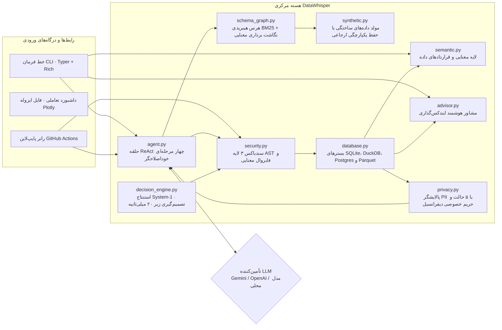

# دیتاویسپر (DataWhisper) — نسخه ۱.۵.۶

**عامل هوشمند، مقتصد و محلی تحلیل داده‌های جدولی و ناظر خودکار تغییرات دیتابیس در Pull Request.**

دیتاویسپر بدون وابستگی به فریم‌ورک‌های سنگین و مبهم (مانند LangChain یا LlamaIndex)، به پرسش‌های تحلیلی شما روی پایگاه‌های داده SQLite، DuckDB، PostgreSQL، Parquet و JSONL پاسخ می‌دهد و بر تغییرات ساختاری دیتابیس در گیت‌هاب نظارت می‌کند.

پروژه مدل زبانی (LLM) را عاملی **غیرقابل‌اعتماد (Zero-Trust)** فرض می‌کند: مدل تنها پیشنهاددهنده کد SQL است؛ درحالی‌که اعتبارسنجی نحو، انطباق با قراردادهای داده، ارزیابی هزینه در پلنر دیتابیس، و پالایش داده‌های هویتی و حساس (PII) در محیط کدهای قطعی، امن و قابل‌بازرسی انجام می‌شود.

---

## فهرست مطالب

- [قابلیت‌های کلیدی](#قابلیت‌های-کلیدی)
- [تازه‌های نسخه ۱.۵.۶](#تازه‌های-نسخه-۱۵۶)
- [معماری سیستم](#معماری-سیستم)
- [امنیت و حاکمیت داده](#امنیت-و-حاکمیت-داده)
- [پایگاه‌های داده و فرمت‌های پشتیبانی‌شده](#پایگاه‌های-داده-و-فرمت‌های-پشتیبانی‌شده)
- [راه‌اندازی سریع](#راه‌اندازی-سریع)
- [دموی خط فرمان](#دموی-خط-فرمان)
- [دستورات CLI](#دستورات-cli)
- [استفاده در پایپ‌لاین CI/CD گیت‌هاب](#استفاده-در-پایپ‌لاین-cicd-گیت‌هاب)
- [تنظیمات و متغیرهای محیطی](#تنظیمات-و-متغیرهای-محیطی)
- [توسعه و آزمون](#توسعه-و-آزمون)
- [مجوز](#مجوز)

---

## قابلیت‌های کلیدی

1. **عامل محلی تحلیل داده مبتنی بر Zero-Trust:** پرسش تحلیلی خود را به زبان طبیعی مطرح کنید. دیتاویسپر با استفاده از سیستم رتبه‌بندی ترکیبی (BM25 به‌همراه پروجکشن برداری تری‌گرام کاراکتری)، اسکیماهای بزرگ را بدون نیاز به مدل‌های ابری هرس کرده و جداول و مسیرهای اتصال (JOIN) مرتبط را برمی‌گزیند. کوئری ایجادشده پیش از رسیدن به موتور، از فایروال معنایی، اعتبارسنجی AST و گیت کنترل هزینه عبور می‌کند.
2. **ناظر خودکار تغییرات در CI/CD:** با باز شدن یا به‌روزرسانی Pull Request، دیتاویسپر تغییرات DDL و فایل‌های مایگریشن را ممیزی می‌کند؛ ورود ستون‌های PII جدید، پس‌رفت پلن‌های اجرایی (تبدیل Index Scan به Seq Scan)، قفل‌های خطرناک روی جداول و کلیدهای خارجی بدون ایندکس را کشف کرده و گزارش جامعی را در قالب کامنت چسبان در PR درج می‌کند.
3. **قراردادهای داده در زمان اجرا (Runtime Data Contracts):** امکان تعریف صریح قیود کیفیت داده (`NOT NULL`، یکتایی مقادیر و حداقل تعداد سطرها) روی جداول با دستور `datawhisper contract` برای جلوگیری از ورود داده‌های مخدوش به خطوط پردازش داده و داشبوردها.
4. **مشاور خودکار ایندکس‌گذاری (Index Advisor):** شناسایی ستون‌های فیلتر و کلیدهای اتصال فاقد ایندکس در کوئری با دستور `datawhisper advise` و پیشنهاد دستور ساخت ایندکس‌های تک‌ستونی و ترکیبی متناسب با دیالکت دیتابیس (Postgres, SQLite, DuckDB) به همراه تخمین درصد کاهش هزینه.
5. **تولید داده‌های ساختگی منسجم (Synthetic Mock Data):** تولید داده‌های تستی واقعی‌نما با مرتب‌سازی توپولوژیک بر اساس روابط وابستگی کلید خارجی (`SyntheticDataGenerator`)، جهت انجام آزمون‌های مطمئن در محیط‌های ایزوله CI بدون نیاز به داده‌های واقعی تولید.

---

## تازه‌های نسخه ۱.۵.۶

| بخش | وضعیت قبلی | بهبودهای نسخه ۱.۵.۶ |
| --- | --- | --- |
| **ورک‌فلوهای CI** | باگ ماتریس دکارتی (۱۶ اجرا) و خطای نسخه‌های آزمایشی | اصلاح ساختار `matrix` در گیت‌هاب اکشنز به نسخه‌های رسمی و پایدار ۳.۱۱، ۳.۱۲ و ۳.۱۳ |
| **حریم خصوصی دیفرانسیل** | عدم شناسایی متغیر محیطی | فعال‌سازی کامل `DW_PII_MODE=differential_privacy` از طریق متغیر محیطی با اعمال نویز کالیبره‌شده لاپلاس |
| **مشاور ایندکس** | ارجاع اشتباه به نام مستعار جدول (Alias) | نگاشت نام‌های مستعار به جداول اصلی در AST و اعمال ضریب اصلاح هزینه بر اساس اسکن‌های کامل جدول |
| **کاتالوگ PostgreSQL** | خطای احتمالی `UnboundLocalError` و نشت شمارش سطرها | مقداردهی اولیه متغیرها، ایزوله‌سازی بر اساس شمای جاری و خواندن قیدهای کلید اصلی از `table_constraints` |
| **ایمنی قراردادهای داده** | خطر آسیب‌پذیری تزریق کاراکتر تک‌کوتیشن | کوت‌گذاری امن شناسه‌ها و مقادیر رشته‌ای در ساخت کوئری‌های اعتبارسنجی قرارداد |
| **پشتیبانی از مدل‌های ۲۰۲۶** | کلاینت منسوخ‌شده سراسری | سازگاری با SDK جدید `google-genai` با ایزولاسیون نمونه، استفاده پیش‌فرض از مدل مدرن `gemini-2.5-flash` |
| **تولید داده‌های ساختگی** | مرتب‌سازی ساده سطحی | مرتب‌سازی توپولوژیک دقیق کان (Kahn's Algorithm) برای رعایت تقدم جداول والد بر فرزند و کلیدهای ترکیبی |
| **کارایی پالایشگر PII** | سربار اعتبارسنجی مدل در هر سلول | استفاده از `@dataclass(slots=True)` و مسیر سریع بررسی زیررشته‌ها قبل از اجرای ریجکس |
| **مجموعه آزمون‌ها** | ۱۷۷ آزمون قبلی | گسترش کامل آزمون‌ها به **۱۹۸ تست سبز و پاس‌شده** همراه با پوشش جامع سناریوهای CLI، مایگریشن و کانفیگ |

---

## معماری سیستم



---

## امنیت و حاکمیت داده

### ۱. فایروال معنایی دو سرعته (`core/security.py` و `core/decision_engine.py`)
کوئری‌ها پیش از هرگونه تحلیل پرهزینه، توسط قوانین سریع امنیتی سنجیده می‌شوند. الگوهای تزریق پرامپت، تلاش برای دسترسی به فایل‌های سیستمی و دستورات مخرب (مانند `DROP` و `TRUNCATE`) بلافاصله رد می‌شوند.

### ۲. سندباکس سه‌لایه AST
- **سطح واژگانی (Lexical):** عدم پذیرش کاراکتر سمی‌کالن (`;`) و نشانه‌های کامنت به منظور جلوگیری از ناهماهنگی بین مفسرها (Parser Differential).
- **سطح ساختاری (Structural):** پذیرش تنها یک دستور مجاز با ریشه مجاز (`SELECT`، `WITH` یا `EXPLAIN`).
- **سطح معنایی (Semantic):** مسدودسازی توابع فرار به محیط سیستم‌عامل (`read_csv`، `system`، `read_file` و غیره).

### ۳. دروازه هزینه (Cost Gate)
- رد خودکار ضرب دکارتی (`CROSS JOIN` یا اتصالات بدون شرط) جهت جلوگیری از قفل شدن رم دیتابیس.
- کنترل محدودیت حجم اسکن بر اساس `EXPLAIN` پلنر دیتابیس و اعمال خودکار سقف `LIMIT`.

### ۴. پالایش داده‌های حساس (PII Scrubbing)
داده‌ها درون خود موتور پالایش می‌شوند و خروجی خام هرگز به خارج درز نمی‌کند:
- `hash`: هش یکپارچه HMAC-SHA256 بر اساس کلید سالت.
- `pseudonymize`: مستعارسازی یکپارچه جهت حفظ امکان اجرای عملیات `JOIN` روی داده‌های ماسک‌شده.
- `differential_privacy`: تزریق نویز لاپلاس به داده‌های تجمیعی با حفظ مرز پایین مقادیر.
- `mask`، `tokenize` و `redact`: روش‌های استاندارد ماسک‌گذاری متنی.

---

## راه‌اندازی سریع

نیاز به **پایتون ۳.۱۱ یا بالاتر**:

```bash
git clone https://github.com/Green-tero/datawhisper.git
cd datawhisper

# نصب پکیج با موتورهای اصلی DuckDB و Arrow
pip install -e ".[duckdb,arrow]"

# یا نصب کامل محیط توسعه با Poetry
poetry install --with dev --extras "duckdb arrow postgres llm"
```

در صورت تمایل به استفاده از مدل‌های زبانی:
```bash
export GEMINI_API_KEY="your-gemini-key"
# یا
export OPENAI_API_KEY="your-openai-key"
```

---

## دموی خط فرمان

```bash
# ایجاد دیتابیس تستی نمونه
python -c "
import sqlite3
c = sqlite3.connect('demo.sqlite')
c.executescript('''
CREATE TABLE customers (id INTEGER PRIMARY KEY, name TEXT, email TEXT);
CREATE TABLE orders (id INTEGER PRIMARY KEY, customer_id INTEGER, amount REAL, status TEXT);
INSERT INTO customers VALUES (1, 'Ada', 'ada@example.com'), (2, 'Alan', 'alan@example.com');
INSERT INTO orders VALUES (1, 1, 120.0, 'paid'), (2, 2, 75.0, 'pending');
''')
c.commit()
"

# ۱. ارزیابی اسکیما و مسیرهای پیشنهادی
datawhisper inspect --source demo.sqlite

# ۲. تحلیل کوئری و پیشنهاد ایندکس‌های بهینه
datawhisper advise "SELECT * FROM orders WHERE status = 'paid'" --source demo.sqlite

# ۳. بررسی قرارداد داده
datawhisper contract --source demo.sqlite --table customers --not-null name --min-rows 2

# ۴. بررسی اعتبار امنیتی و هزینه بدون اجرای واقعی
datawhisper explain "SELECT * FROM customers c JOIN orders o ON c.id = o.customer_id" --source demo.sqlite

# ۵. پرسش به زبان طبیعی
datawhisper ask "which customers have paid orders?" --source demo.sqlite
```

---

## توسعه و آزمون

اجرای دروازه‌های بررسی کیفیت کد:

```bash
# اجرای کل سوئیت آزمون‌ها (۱۹۸ تست)
poetry run pytest -v

# بازرسی لینتر
poetry run ruff check .

# بازرسی فرمت کد
poetry run black --check .

# آزمون استاتیک تایپ‌ها
poetry run mypy datawhisper
```

---

## مستندات تفصیلی

- راهنمای کامل تنظیمات و متغیرهای محیطی: [docs/configuration.md](configuration.md)
- تاریخچه تغییرات و نسخه‌ها: [CHANGELOG.md](../CHANGELOG.md)
- خط‌مشی امنیت و گزارش آسیب‌پذیری‌ها: [SECURITY.md](../SECURITY.md)

---

## مجوز

دیتاویسپر تحت مجوز نرم‌افزار آزاد [Apache-2.0](../LICENSE) منتشر شده است.
